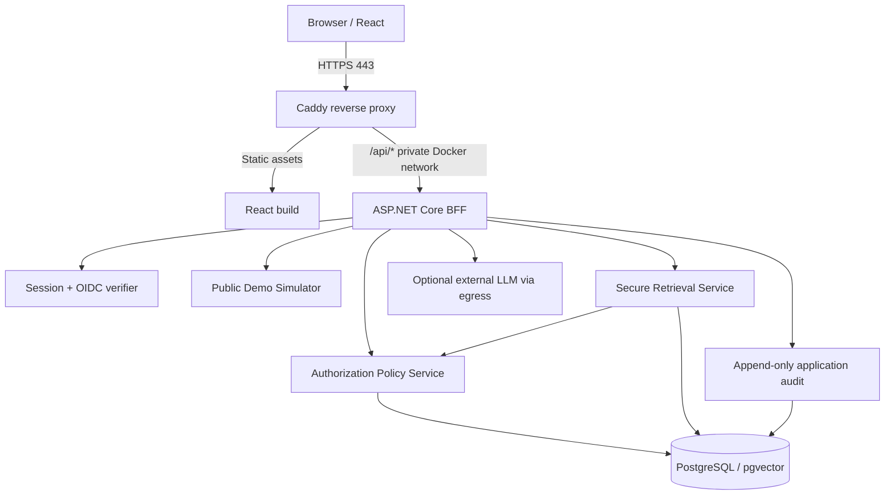
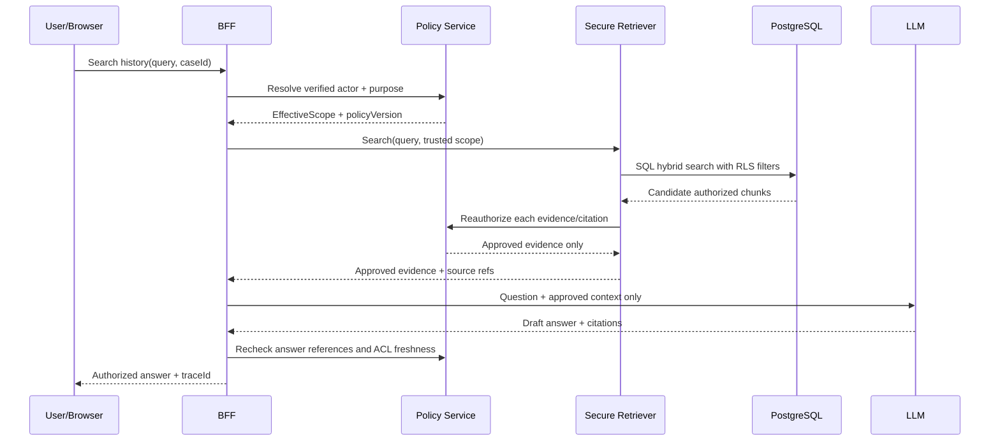

# MarcheAgents — 可解释、可审计的企业级 AI Agent 展示平台

**Platform Implementation Blueprint | React + ASP.NET Core BFF + PostgreSQL/pgvector + Docker Compose + Oracle Cloud Always Free**

- 文档版本：v2.0 — 品牌与多 Feature 平台升级
- 日期：2026-11-18
- 目标：可以交给 GitHub Copilot / 开发 Agent 分阶段实现、测试、部署
- **正式产品 / 项目名：MarcheAgents**
- **主域名：`marcheagents.com`**（用户提供；域名所有权、DNS 配置和当前服务状态需要部署时验证）
- **GitHub 仓库建议：`marcheagents`**
- **首个 Feature：Email Support Agent**（页面显示名，可在配置中调整；不是整个平台的名称）
- **后续规划：可添加其他 Agent Feature**，初期无需实际开发其他 Agent
- 演示数据：完全合成的 ABC Group / Sydney / Melbourne / Brisbane 邮件，不接入真实客户数据
- 主要约束：一台 Oracle Cloud ARM64 Always Free VM（保守按 2 OCPU / 12 GB RAM 设计）

---

## 平台定位与扩展边界（新增，实施优先级最高）

### P.1 产品结构

```text
MarcheAgents (marcheagents.com)
├── Public Website / Landing
├── Feature Catalog
│   ├── Email Support Agent             [AVAILABLE — 唯一实际 Feature]
│   ├── Future Feature Placeholder #1   [COMING SOON — 不可点击启动]
│   └── Future Feature Placeholder #2   [COMING SOON — 不可点击启动]
├── Shared Demo Runtime
│   ├── Scenario Definition / Step Player
│   ├── Identity Simulation / Live Session
│   ├── Policy Decision Inspector
│   ├── Evidence / Context Inspector
│   └── Trace & Audit Timeline
└── Platform Services (后续逐步实现)
    ├── Auth / Identity / RBAC + ReBAC
    ├── Feature Registry + Feature Flags
    ├── Secure Retrieval / Policy Enforcement
    ├── AI Provider Abstraction
    └── Audit / Observability
```

**命名规则**：页面品牌显示 `MarcheAgents`；业务功能显示 `Email Support Agent`；C# 根命名空间统一 `MarcheAgents.*`；前端包名 `marcheagents-web`；数据库名可用 `marcheagents`；日志 service name `marcheagents-api`。`SecureMail` 只作为历史文档名，不用于新代码、UI、镜像、Cookie、目录或部署资源。

### P.2 未来 Feature 的最小接入契约

平台定义可扩展的 Feature Registry。第一版可以用静态 TypeScript 配置驱动，后续由 BFF 提供获授权、经过校验的 Catalog；前端注册表**不承担安全授权**。

```ts
export interface AgentFeatureDefinition {
  id: string;                      // stable slug: email-support
  title: string;
  shortDescription: string;
  category: 'customer-ops' | 'compliance' | 'operations' | 'other';
  icon: string;
  publicRoute: string;             // /features/email-support/demo
  liveRoute?: string;              // /app/features/email-support
  status: 'available' | 'coming-soon' | 'disabled';
  capabilities: Array<'explainable' | 'auditable' | 'permission-aware' | 'human-review'>;
  demoScenarioIds: string[];
}
```

原则：

1. Feature 独有的 Case、邮件和分类逻辑放在 `features/email-support`，不可侵入平台 Shell。
2. 公共的 Policy Inspector、Trace Timeline、Evidence Viewer 和 Auth Shell 设计为 **shared platform components**，不同 Feature 只传可见证据、规则代码和已授权 Trace。
3. 每个 Feature 的 scenario、routes、backend endpoints、数据迁移、权限资源类型、审计事件都需有模块命名空间（如 `email-support.*`）。
4. 未来不同 Feature 可以有不同的工作流步数，不要把全平台底层 Demo Engine 写死为“五步”或邮件专属状态。
5. Feature Flags 默认关闭；`coming-soon` 不允许虚构可操作流程，也不能误导用户认为已上线。
6. 一期仍采取 **模块化单体（Modular Monolith）**：单一 React App、单一 .NET BFF、单一 PostgreSQL；不要为未知 Feature 预先拆微服务。
7. 平台级管理员不能仅凭菜单入口越过具体业务资源的授权规则，未来 Feature 之间也应默认隔离。

### P.3 页面信息架构与域名约定

| URL | 用途 | 当前状态 |
|---|---|---|
| `https://marcheagents.com/` | MarcheAgents 品牌 Landing、平台价值与 CTA | Phase 1 |
| `https://marcheagents.com/features` | Agent Feature Catalog | Phase 1 |
| `https://marcheagents.com/features/email-support` | 功能介绍、架构、价值与“Try Demo” | Phase 1 |
| `https://marcheagents.com/features/email-support/demo` | 五步邮件处理公开交互演示 | Phase 1 |
| `https://marcheagents.com/features/email-support/security` | 合成数据安全实验 | Phase 1 |
| `https://marcheagents.com/app/features/email-support` | 登录后的 Live Workspace | Phase 3+ |
| `https://marcheagents.com/app/features/email-support/cases/:caseId` | Case Detail | Phase 3+ |
| `https://marcheagents.com/app/audit/:traceId` | 获授权审计查看 | Phase 3+ |
| `https://www.marcheagents.com/*` | 统一 308 重定向至根域 | Phase 6 |

可保留原 `/demo`、`/demo/security`、`/app` **兼容重定向**，但新功能的链接均采用明确的 Feature 路由。不要建立邮件客服专属的二级域名作为平台主入口。`/api/*` 永远由 BFF 处理，未认证接口的内容必须是纯合成数据。

### P.4 品牌与主页文案（指导实施）

- **Logo 文字**：MarcheAgents；无需依赖第三方图像资产；首版可用文字 Logo + 简单图标。
- **英文 Hero**：`Enterprise AI Agents. Explainable by Design. Auditable by Default.`
- **副标题**：`Explore how AI agents handle real-world workflows with policy-aware retrieval, traceable evidence and human oversight.`
- **Primary CTA**：`Explore Agent Demos` → `/features`。
- **Featured Agent**：`Email Support Agent` / `Interactive Demo` → `/features/email-support/demo`。
- **Capabilities**：Explainability、Auditability、Permission-Aware Retrieval、Human-in-the-Loop。
- **状态标签**：只给 Email Support Agent `Available`；其余用 `Coming Soon`，不造假已有功能或客户案例。
- **页脚**：MarcheAgents、`marcheagents.com`、Demo disclaimer、Privacy/Contact（若未提供真实链接，使用明确 TODO，不能虚构）。

**设计边界**：首屏是 MarcheAgents 平台和可复用 AI Agent 能力，不要让访客误以为产品只处理邮件；`Email Support Agent` 是 Featured Demo 和唯一当前交互入口。用户品牌字样与域名按上述大小写/拼写精确保留。

---

## 0. Executive Decision / 不可变设计原则

**MarcheAgents 是面向多种企业业务场景的 AI Agent 能力展示平台，不是邮件客服专用产品。** 当前唯一可操作的 Feature 为 **Email Support Agent**，演示 **Email → Multi-Project Cases → Permission-Aware RAG → Explainable Answer → Audit Evidence**。将来新增 Agent Feature 时，应复用平台的导航、身份、审计、权限、观测与部署能力。

1. **Platform-first, feature modular**：平台 Landing、Feature Catalog、共享安全和审计基础设施与 Email Feature 分离；一个 Feature 不得写死整个平台的路由、文案或数据库结构。
2. **Public Demo**：匿名用户可以看到完整故事，但所有邮件、联系人、Case、检索结果和权限均为静态合成数据。前端身份切换只用于动画，绝不被视作真实认证。
3. **Protected Live Demo**：由 BFF 完成 OIDC 登录、服务端权限判断、检索和可选 LLM 调用；浏览器不保留 OAuth access token，也不直接调用 DB / LLM。
4. **Default Deny**：未知用户、未知项目、未分类敏感信息、权限冲突、跨项目不可拆分文档均默认拒绝。
5. **Filter before retrieve**：权限必须在检索数据源执行；检索后还需重新授权。不得先取全部邮件再靠 LLM 提示词过滤。
6. **Case != Thread**：一封邮件可关联多个 Case；一个 Thread 也可跨多个 Case。原始邮件是可信来源记录，安全检索片段是派生记录。
7. **Explainability without leaking**：外部演示身份可以看到准入证据，不展示拒绝资源的真实标题、摘要、embedding、关联对象 ID 或不存在性细节。演示的“被拒绝模拟记录”必须明确标注为合成可视化，不来自真实授权接口。
8. **Auditable**：检索请求、使用的授权策略版本、数据源引用、LLM 调用与输出审批记录可以关联追溯；审计日志本身不记录敏感原文或密钥。
9. **No direct autonomous sending**：AI 仅生成回复草稿。首版不发送真实邮件，不开放通用 Web 抓取、任意 SQL、任意代码执行工具。
10. **No secrets in frontend / git / image**：所有真实凭据留在服务端，生产采用限制访问的 secret 文件或专门 Secret Manager。
11. **Cost boundary**：Oracle VM 运行应用和数据库；不在 2 OCPU ARM VM 上托管大模型。Live Mode 可调用明确配置的外部 LLM，费用另计；未配置时仍可运行完整 Demo Mode。
---

## 1. 成果范围、非目标与完成定义

**注意**：以下邮件场景全部属于 `Email Support Agent`，不是 MarcheAgents 平台唯一长期业务能力。平台 Landing / Feature Catalog 的验收与本场景同级重要。

### 1.1 必须展示的业务故事

ABC Group 的一封邮件：

> From: manager@abc.example  
> Subject: Cleaning and Staffing Concerns  
> Our Sydney office cleaning was unsatisfactory yesterday. We also have a staffing issue at our Melbourne warehouse. Please investigate both issues.

系统显示五个步骤：

1. **Incoming Email**：显示原始邮件与 `Message-ID`、接收时间、发件人。
2. **AI Classification**：识别 `CLEANING_COMPLAINT` / Project A、`STAFFING_ISSUE` / Project B；提示模型建议不是授权决策。
3. **Case Routing**：一封 `E-5001` 关联 `A-101` 与 `B-201`；各自拥有独立 SLA、负责人、可检索片段。
4. **Secure Retrieval**：以 Alice（仅 A）、Carol（A+B）、David（A+B+C）的不同登录身份演示服务器允许的检索范围。Public Mode 使用预定义模拟身份；Live Mode 使用真实登录会话和权限。
5. **AI Response & Evidence**：生成可审阅的草稿，右侧显示 Evidence / Policy Decision / Trace ID / Audit Timeline。

### 1.2 额外的展示功能

- AI Context Inspector：展示实际**进入 LLM**的授权 chunk（仅当前真实用户有权查看的内容）。
- Policy Decision Inspector：显示允许/拒绝的**理由代码**，如 `PROJECT_MEMBERSHIP_REQUIRED`、`MESSAGE_RESTRICTED`，不暴露资源元数据。
- Audit Timeline：EmailReceived → Classified → ProjectResolved → CaseLinked → RetrievalAuthorized → DraftGenerated。
- Security Test Mode：可运行 10 个固定合成数据攻击场景；输出“测试通过/失败”的真实后端结果（不可仅前端假装通过）。
- Toggle：`Public Story` / `Protected Live`，Live 不可用时给出受控提示。

### 1.3 不在 MVP 的范围

真实邮箱接入、真实外发邮件、多租户商用计费、完整案件审批流、分布式 Agent 调度、第三方工作流平台、真实客户上传、GPU 自托管 LLM、Kubernetes、复杂文件解析均推迟。

### 1.4 完成定义（DoD）

- 本地 Docker 一条命令可以启动公开演示。
- Oracle ARM64 主机可以 HTTPS 访问演示页面。
- PostgreSQL、BFF、后台 Job 不向公网映射端口。
- 公开匿名接口无法读取真实 Live 数据，也无法触发收费的 LLM 调用。
- 已登录 Alice 无法通过修改 URL、Body、query、case_id 或 tool call 访问 B/C 的任意 Case、Chunk、邮件、附件和摘要。
- 同一封跨项目邮件拆分后，Alice 的 LLM Context 不包含 B 的正文。
- 所有 Live 检索/草稿操作有审计 `trace_id`，可复现当时的授权判定版本。
- CI 执行授权负向测试、RLS 集成测试、API 测试、Playwright E2E、镜像 ARM64 构建。

---

## 2. Technology Stack

| 层 | 技术 | 选择原因 |
|---|---|---|
| UI | React + TypeScript + Vite | 演示交互、组件隔离、静态资源易部署 |
| UI 工具 | Tailwind CSS, shadcn/ui, Lucide | 快速构建专业的企业展示界面 |
| 动画 | Framer Motion（可选） | Case 分流、权限卡片动画 |
| Server | ASP.NET Core（受支持 LTS 版本） | 强类型 API、Policy Service、可与现有 .NET 技能复用 |
| Authentication | OIDC Authorization Code + PKCE via BFF | 服务端 Session/Cookie，前端不持有令牌 |
| Data | PostgreSQL + pgvector | Case/ACL/Embedding 同库，事务更简单 |
| Search | PostgreSQL FTS + pgvector | MVP 混合检索，无额外搜索集群 |
| Reverse proxy | Caddy | TLS 自动化、静态站点、反代 `/api` |
| Jobs | .NET HostedService（轻量） | 对合成数据进行可控的后台处理；无需专用队列初期 |
| Deployment | Docker Compose on Oracle ARM64 | 低成本单机部署 |
| Test | xUnit + Testcontainers + Vitest + Playwright | 重点验证权限和 UI |
| Observability | JSON logs + OpenTelemetry-friendly trace IDs | 便于演示和审计 |

所有 Docker 镜像应支持 **linux/arm64**；在 CI 构建和部署前验证 manifest。不要默认 amd64 镜像能在 Oracle Ampere A1 运行。

---

## 3. 系统架构及网络信任边界



### 3.1 Trust boundaries

- **Public network**：仅 Caddy 映射 TCP 80/443。可选 SSH 22 仅授权管理 IP。
- **Docker private network**：BFF、Postgres 等仅 Docker 内互通，不映射 5000/5432/8000/11434。
- **BFF boundary**：验证真实用户、CSRF、速率限制、授权、审计、输出控制。
- **Data boundary**：SQL/RLS 和每条资源可见性策略。数据库为最后一道防线。
- **Model boundary**：模型只获得经过验证的证据和受限工具，不允许直接 DB/network/shell 访问。

### 3.2 Authentication split

**Public Demo**：`/features/email-support/demo` 的场景固定、没有可写永久业务数据；前端角色选择只作用于模拟状态。Public Demo API 不应该接受任意 `customer_id` 并调用真实数据搜索。

**Protected Live**：`/app/*` 要求真实 OIDC 登录。Cookie 必须 `Secure`, `HttpOnly`, `SameSite=Lax`（按回调流程调整）；修改型 HTTP 方法需要 CSRF 保护；服务端维护会话；权限源由 DB/IdP 映射，不信任浏览器传来的 `role`、`allowed_projects` 或 `is_admin`。

**重要**：即使身份提供商支持外部测试用户，也不允许通过纯前端下拉框切换为 Carol/David 的真实身份。若需要演示多身份，请准备三套明确的测试账户；Public Demo 的虚拟角色切换与 Protected Live 的真实账户切换用不同的 UI 标签和数据源。

---

## 4. 前端页面规格

### 4.1 路由

| Route | 功能 | 访问 |
|---|---|---|
| `/` | MarcheAgents Landing：通用平台定位、Feature Catalog CTA、Featured Email Agent | 公开 |
| `/features` | Agent Feature Catalog（仅邮件已可用，其他 Coming Soon） | 公开 |
| `/features/email-support` | Email Support Agent 详情及 Try Demo CTA | 公开 |
| `/features/email-support/demo` | Email Support Agent 5-step 可交互故事 | 公开合成数据 |
| `/features/email-support/security` | Email Support Agent 合成数据权限实验 / 红队场景 | 公开 |
| `/app/features/email-support` | 真实登录后 Email Workspace | OIDC Session |
| `/app/features/email-support/cases/:caseId` | Case Detail / Email Timeline / Evidence | Case 授权 |
| `/app/audit/:traceId` | 本用户有权查看的审计视图 | 专门授权 |
| `/healthz` | 最小健康检查 | 代理或 BFF；不公开敏感配置 |

### 4.2 `/features/email-support/demo` 三栏布局

- **左侧（25%）**：Step Navigator + Current Identity + Customer/Project Tree。
- **中间（45%）**：Email Viewer → AI Intent Cards → Case Split → Retrieved Evidence → Reply Draft。
- **右侧（30%）**：AI Context Inspector + Policy Decisions + Audit Timeline。
- 窄屏改为上下布局，顶部 5 步进度条；Inspector 用 tabs 切换，确保移动端可用。

### 4.3 关键 React 组件

```text
src/
  app/App.tsx
  app/router.tsx
  pages/LandingPage.tsx
  pages/FeatureCatalogPage.tsx
  pages/FeatureOverviewPage.tsx
  features/registry.ts
  features/email-support/scenario.ts
  components/platform/PlatformHeader.tsx
  components/platform/FeatureCard.tsx
  pages/PublicDemoPage.tsx
  pages/SecurityLabPage.tsx
  pages/LiveWorkspacePage.tsx
  components/demo/DemoStepper.tsx
  components/demo/EmailViewer.tsx
  components/demo/IntentClassificationPanel.tsx
  components/demo/CaseSplitVisualizer.tsx
  components/demo/IdentitySwitcher.tsx
  components/demo/SecureRetrievalPanel.tsx
  components/demo/AIReplyDraftPanel.tsx
  components/inspectors/AIContextInspector.tsx
  components/inspectors/PolicyDecisionInspector.tsx
  components/inspectors/AuditTimeline.tsx
  components/common/ModeBadge.tsx
  lib/apiClient.ts
  data/publicScenario.ts
  types/scenario.ts
  types/security.ts
```

### 4.4 UI 状态模型

```ts
export type DemoStep =
  | 'incoming-email'
  | 'classification'
  | 'case-routing'
  | 'secure-retrieval'
  | 'ai-reply';

export type DemoIdentity = 'alice' | 'carol' | 'david';
export type RuntimeMode = 'public-simulation' | 'protected-live';

export interface EvidenceCard {
  evidenceId: string; // 仅已授权证据可包含真实 ID
  caseId: string;
  projectLabel: string;
  excerpt: string;
  citation: string;
}

export interface PolicyTrace {
  traceId: string;
  policyVersion: number;
  decision: 'allow' | 'deny';
  reasonCode: string;
  // 不在匿名响应中携带真实被拒资源名称/ID
}
```

交互要求：Next/Previous 可重复，身份切换即时重新计算模拟结果，刷新页面也可以从 URL step 参数恢复。显示证据的组件必须**只**拿到“允许的证据列表”，而不是拿到全量资料后隐藏其 CSS。

### 4.5 Explainability UI 与隐私

Inspector 至少含三个 Tab：

1. **Evidence Sent to LLM**：证据 ID（可授权展示）、来源、短引用、为何相关；只显示实际发送的证据。
2. **Policy Evaluation**：允许/拒绝统计、策略版本、授权理由代码。对未授权对象只显示聚合数量，不显示其真实 ID 或内容。
3. **Audit Events**：按时间显示 correlation/trace ID、动作、结果和耗时。

演示页明确标注：`SIMULATED DATA / SIMULATED POLICY`。真实 Live UI 标注 `SERVER-ENFORCED POLICY`，且审计信息必须由后端产生。

---

## 5. Domain Model / DB 模型

### 5.1 业务实体

```text
Customer 1:N Project
Customer 1:N Contact
Contact N:M Project via ProjectMembership
Project 1:N Case
Case N:M Contact via CaseParticipant
EmailThread 1:N EmailMessage
EmailMessage N:M Case via CaseEmailLink
EmailMessage 1:N EmailSegment
EmailSegment 1:N RetrievalChunk
ResourceGrant --> authorized principals / resources
AccessAudit --> actor, action, resource category, policy version, trace
```

**原始邮件不能因 Case 拆分而复制**。一封邮件关联多个 Case；可用于检索的 segment 应在项目/敏感度边界上分开，无法安全拆分则设 `REVIEW_REQUIRED` 且默认不入可检索索引。

### 5.2 核心字段

- `customers`: `id`, `name`, `status`
- `projects`: `id`, `customer_id`, `name`, `site_code`, `status`
- `contacts`: `id`, `customer_id`, `email_normalized`, `display_name`, `active`
- `project_memberships`: `principal_id`, `project_id`, `role`, `valid_from`, `valid_to`, `can_read_case`, `can_approve`
- `cases`: `id`, `customer_id`, `project_id`, `title`, `classification`, `status`, `owner_id`, `created_at`
- `case_participants`: `case_id`, `principal_id`, `participation_role`, `history_access_mode`, `valid_from`, `valid_to`
- `email_messages`: `id`, `thread_id`, `message_id_header` (unique when applicable), `sender`, `sent_at`, `received_at`, `raw_object_key`, `content_hash`, `classification`
- `case_email_links`: `case_id`, `email_id`, `linked_by`, `link_reason`
- `email_segments`: `id`, `email_id`, `case_id`, `scope_rule`, `visibility_policy_id`, `content`, `verification_status`, `source_provenance`
- `retrieval_chunks`: `id`, `segment_id`, `customer_id`, `project_id`, `case_id`, `classification`, `visibility_policy_id`, `acl_version`, `text`, `embedding`, `tsvector`
- `resource_grants`: `principal_id`, `resource_type`, `resource_id`, `permission`, `history_access_mode`, `effective_from`, `effective_to`
- `access_audits`: `id`, `trace_id`, `actor_id`, `action`, `resource_type`, `decision`, `reason_code`, `policy_version`, `timestamp`, `metadata_safe`

### 5.3 重要的 Row-Level Security

- 在 `email_segments`、`retrieval_chunks`、`cases`、`email_messages` 等敏感表启用并设计 RLS。
- 查询角色不应是 superuser、表 owner 或拥有 `BYPASSRLS` 的角色。
- `ALTER TABLE ... FORCE ROW LEVEL SECURITY` 可加固表 owner 行为，但不约束 superuser / BYPASSRLS 角色。
- 用事务级 `SET LOCAL app.actor_id = ...` 等可信上下文 + policy joins，严禁用前端可控字段直接设授权上下文。
- 数据库连接池必须确保事务边界隔离；建议每个检索在明确事务中设置 scope，关闭时释放，测试同一物理连接复用场景。
- 资源可能需要 `ALL_OF_PROJECTS` 或特定 `resource_grants` 才能访问，不能用 `project_id IN (A,B)` 就认为跨项目片段可由任一项目成员读取。
- 撤权事件必须触发 ACL version 更新、缓存失效，并让后续查询重新授权。

**注意**：不要把此文档中的模型字段列表直接当作完整 DDL。先实现 DB migration + Policy predicates，再配套负向测试证明安全性。

---

## 6. Authorization & Secure RAG

### 6.1 范围判定

服务端计算 `EffectiveScope(actor, purpose, customer, requested_case)`：

```text
identity = verified BFF session
allowed_projects = membership valid now + explicit grants
allowed_cases = case membership and case policy
allowed_messages = email/segment visibility and history rule
allowed_actions = search, read, draft, approve, export (separate)
purpose = complaint_investigation / followup / demo_validation
policy_version = latest applied version
```

规则：**客户归属相同不代表可互相查看内容；组织职级高不自动授权；加入 Case 不自动授予历史邮件完整访问权。**

### 6.2 Retrieval Pipeline



### 6.3 单封跨项目邮件的处理

示例 `E-5001`：

- `SEG-A` = Sydney cleaning complaint, `project A`, `case A-101`。
- `SEG-B` = Melbourne staffing issue, `project B`, `case B-201`。
- 两者的原始证据都指向 `E-5001`，但 Retrieval API 返回只与授权 Segment 对应的片段。
- 原始邮件全文和带其它项目的引用历史不能直接给 Alice 阅读或生成 draft。
- 对涉及多个项目且无法可靠拆分的一个 Segment：不发布到普通索引，转入人工审查或要求同时具备所有资源访问权限。

### 6.4 概念性 C# service contract

```csharp
public interface IAuthorizationService
{
    Task<EffectiveScope> ResolveScopeAsync(
        AuthenticatedActor actor,
        Guid customerId,
        string purpose,
        CancellationToken ct);

    Task<AuthorizationDecision> AuthorizeResourceAsync(
        AuthenticatedActor actor,
        ResourceRef resource,
        string operation,
        CancellationToken ct);
}

public interface ISecureRetrievalService
{
    Task<IReadOnlyList<AuthorizedEvidence>> SearchAsync(
        AuthenticatedActor actor,
        SearchRequest request,
        CancellationToken ct);
}

public interface IReplyDraftService
{
    Task<ReplyDraft> DraftAsync(
        AuthenticatedActor actor,
        Guid caseId,
        CancellationToken ct);
}
```

关键点：`AuthenticatedActor` 从 BFF Session 解析；不能由 HTTP body 直接传入身份。`AuthorizedEvidence` 只允许从带鉴权的 Retriever 建立，Controller 不能用任意 Chunk 构造它。

### 6.5 LLM 安全约束

- 模型不直接连接 PostgreSQL，不授予读文件、shell、任意 URL、邮件发送权限。
- 由 BFF 建立 Context，仅包含 reauthorized evidence。
- Email body、附件及检索证据视为 **不可信数据**，其中“忽略规则 / 执行指令”的句子不能改变工具权限。
- 模型输出要验证结构、引用 ID、权限版本和敏感数据泄漏；只生成 draft，不自动外发。
- 记录 `model_id`, `prompt_template_version`, `evidence_ids`, `policy_version`, `latency_ms`, `token_usage`；审计数据默认不记录原始秘密与全部提示词。
- 一切真实模型调用需 server-side rate limiting、超时、重试限额、并发上限、预算上限；匿名 Public Demo 不调用付费模型。

---

## 7. API Contracts

| Method | Endpoint | 用途 | 权限 |
|---|---|---|---|
| GET | `/api/public/scenario` | 固定模拟邮件、合成 Case、可视化步骤 | 公开、严格静态 |
| POST | `/api/public/simulate` | 固定场景的角色切换结果，不访问真实资料 | 公开、限流、白名单参数 |
| GET | `/api/auth/me` | 当前登录用户与授权 UI 功能 | Session |
| GET | `/api/app/cases` | 当前用户授权 Case 列表 | Session + policy |
| GET | `/api/app/cases/{id}` | Case Detail | Case policy |
| POST | `/api/app/search` | 授权历史查询 | Session + CSRF + scope |
| POST | `/api/app/cases/{id}/draft` | 生成回复草稿 | Session + CSRF + rate limit |
| GET | `/api/app/audit/{traceId}` | 本人授权查看的审计事件 | Audit policy |
| GET | `/api/healthz` | 最小 readiness | 仅状态信息 |

### 7.1 公开模拟请求（白名单）

```json
{ "scenarioId": "abc-multiproject-001", "demoIdentity": "alice", "step": "secure-retrieval" }
```

只允许预定义值，不接受任意 Prompt、真实 customer ID、raw SQL 或数据库检索条件。

### 7.2 Protected Live 搜索请求

```json
{
  "caseId": "00000000-0000-0000-0000-000000000101",
  "query": "What happened to the Sydney cleaning complaint?",
  "purpose": "complaint_investigation"
}
```

后端自行导出 actor、tenant/customer、project scope。`caseId` 不存在或未授权时，外部响应应避免区分（例如统一 404 或模糊拒绝策略），实际原因写入内部审计。

### 7.3 Live 响应（仅已授权证据）

```json
{
  "traceId": "trace-demo-001",
  "policyVersion": 7,
  "answer": "The Sydney complaint is under investigation.",
  "evidence": [
    {
      "id": "evidence-a-101",
      "caseId": "A-101",
      "excerpt": "Cleaning quality concern reported for Sydney.",
      "citation": "E-100 / approved segment"
    }
  ],
  "policySummary": {
    "authorizedEvidenceCount": 1,
    "withheldEvidenceCount": 0
  }
}
```

注意：`withheldEvidenceCount` 在真实外部用户接口中也可能泄露信息存在性，默认省略或仅在受授权的内部审计视图展示；公开模拟接口可以显示合成的拒绝数量。

---

## 8. Public Demo Scenario Seed

```text
Customer ABC Group
  Project A / Sydney Office
  Project B / Melbourne Warehouse
  Project C / Brisbane Retail

Contacts (simulation only)
  Alice / Site Supervisor / A
  Carol / Regional Manager / A,B
  David / Account Director / A,B,C

Incoming mail E-5001
  Segment A -> A-101 Cleaning Complaint
  Segment B -> B-201 Staffing Issue

History:
  E-100 / A / Sydney cleaning complaint
  E-101 / A / Investigation update
  E-200 / B / Staffing incident
  E-201 / B / Roster revision
  E-300 / C / Invoice query

Expected:
  Alice -> only A evidence
  Carol -> A + B evidence, except any separately restricted messages
  David -> A + B + C evidence, except separately restricted messages
```

全部姓名、邮箱、项目均为合成测试数据。不要复用真实客服邮件、脱敏不完整的日志或客户合同。

---

## 9. Repo Structure

**必须以 `marcheagents` 为仓库根目录；以下是目标结构。**

```text
marcheagents/
├── README.md
├── docs/
│   ├── MarcheAgents_Implementation_Blueprint.md
│   ├── feature-extension-guide.md
│   ├── architecture.md
│   ├── threat-model.md
│   ├── access-policy.md
│   ├── oracle-deployment.md
│   ├── runbook.md
│   └── acceptance-checklist.md
├── frontend/
│   ├── Dockerfile
│   ├── package.json
│   ├── vite.config.ts
│   └── src/
│       ├── app/             # shared routes + shell
│       ├── features/
│       │   ├── registry.ts
│       │   └── email-support/
│       └── shared/          # context, policy, audit UI
├── backend/
│   ├── MarcheAgents.Api/
│   ├── MarcheAgents.Application/
│   ├── MarcheAgents.Domain/
│   ├── MarcheAgents.Infrastructure/
│   ├── MarcheAgents.Migrations/
│   ├── Features/EmailSupport/
│   ├── Platform/Authorization/
│   ├── Platform/Auditing/
│   └── tests/
├── infra/
│   ├── Caddyfile
│   ├── compose.yaml
│   ├── .env.example
│   ├── secrets/               # not committed
│   └── scripts/
│       ├── deploy.sh
│       ├── backup-db.sh
│       └── restore-db.sh
├── tests/
│   ├── e2e/
│   ├── security/
│   └── performance/
└── .github/workflows/ci.yaml
```

### 9.1 建议按 vertical slice 而非一次性生成所有组件

先完成静态端到端故事，再接入后端，然后逐步增加数据库和授权检索。每个阶段都确保 `docker compose up` 仍可演示。

---

## 10. Docker & Oracle Cloud 部署

### 10.1 Oracle 免费额度与主机选择

截至 **2026-11-18**，Oracle 官方 Always Free 文档所列纯 Always Free Tenancy 的 Ampere A1 免费月额度为 **1,500 OCPU-hours + 9,000 GB-hours**，相当于一台 **2 OCPU / 12 GB RAM** 机器持续运行；Always Free Block Volume 合计 **200 GB**。不同账户类型 / PAYG 的免费额度可能不同，实际以当前 Tenancy Console 和官方文档为准。A1 可能因区域库存不足无法创建。不要按旧的“所有用户 4 OCPU / 24GB”教程规划。

官方参考：
- https://docs.oracle.com/en-us/iaas/Content/FreeTier/freetier_topic-Always_Free_Resources.htm
- https://docs.oracle.com/en-us/iaas/Content/FreeTier/freetier.htm
- https://www.oracle.com/cloud/free/faq/

**建议初期**：Ubuntu 24.04 LTS ARM64（检查 Oracle 当下支持镜像），2 OCPU / 12 GB，50–100 GB boot volume，单 VM。检查创建的计算实例、卷、负载均衡和网络是否均标记 Always Free；不要误选付费 shape。

### 10.2 资源预算（非性能保证）

| 组件 | 建议 RAM 容量 / 上限 | 说明 |
|---|---|---|
| PostgreSQL + pgvector | 2–3 GB | 小型合成语料，避免重建巨大索引 |
| ASP.NET Core API | 1–2 GB | 不在服务内加载大模型 |
| Caddy | < 256 MB | 静态文件与 TLS |
| Host + cache + logs | 3–4 GB | 留足文件缓存和系统余量 |
| 其余 | 预留 | 不要将容器内存限制总和配置到 12GB 极限 |

CPU 2 OCPU 优先保证 API 交互，后台 embedding 建索引应限速或离线预生成。公开 Demo 默认使用静态生成的 mock evidence。

### 10.3 生产 Compose 示例（框架）

**前提**：项目已有已构建并验证 arm64 的镜像；应用从 `/run/secrets/...` 读取密码；真实部署应固定镜像版本/摘要，不使用 floating latest。

`infra/compose.yaml`：

```yaml
services:
  caddy:
    image: caddy:2
    restart: unless-stopped
    environment:
      APP_DOMAIN: ${APP_DOMAIN:-marcheagents.com}
    ports:
      - "80:80"
      - "443:443"
    volumes:
      - ./Caddyfile:/etc/caddy/Caddyfile:ro
      - caddy_data:/data
      - caddy_config:/config
      - ../frontend/dist:/srv:ro
    depends_on:
      - api
    networks: [front]
    security_opt:
      - no-new-privileges:true

  api:
    image: ${API_IMAGE:?set_API_IMAGE}
    restart: unless-stopped
    environment:
      ASPNETCORE_URLS: http://0.0.0.0:8080
      ASPNETCORE_ENVIRONMENT: Production
      Database__Host: db
      Database__Name: marcheagents
      Database__User: marcheagents_app
      Database__PasswordFile: /run/secrets/db_app_password
      Demo__PublicEnabled: "true"
      Live__Enabled: "false"
    secrets:
      - db_app_password
    depends_on:
      db:
        condition: service_healthy
    expose:
      - "8080"
    networks: [front, back]
    read_only: true
    tmpfs:
      - /tmp
    cap_drop: [ALL]
    security_opt:
      - no-new-privileges:true

  db:
    image: pgvector/pgvector:pg17
    restart: unless-stopped
    environment:
      POSTGRES_DB: marcheagents
      POSTGRES_USER: postgres
      POSTGRES_PASSWORD_FILE: /run/secrets/db_admin_password
    secrets:
      - db_admin_password
    volumes:
      - postgres_data:/var/lib/postgresql/data
    healthcheck:
      test: ["CMD-SHELL", "pg_isready -U postgres -d marcheagents"]
      interval: 10s
      timeout: 5s
      retries: 10
    networks: [back]
    security_opt:
      - no-new-privileges:true

secrets:
  db_admin_password:
    file: ./secrets/db_admin_password
  db_app_password:
    file: ./secrets/db_app_password

networks:
  front:
  back:
    internal: true

volumes:
  postgres_data:
  caddy_data:
  caddy_config:
```

**必须补齐的实现项**：

- API 镜像使用专用非 root 用户；目录与文件访问权限要能支持 `read_only`。
- 由 migration/admin 初始化 `marcheagents_app` 最小权限账户、设置其密码和授权；不能直接让 API 以 `postgres` 超级用户运行。
- Postgres 镜像 ARM64 和特定 tag 的兼容性必须在构建/部署前验证；若 tag 不可用，固定一个受维护的 ARM64 兼容 PostgreSQL/pgvector 镜像。
- `Database__PasswordFile` 是示例自定义配置，应用必须明确实现 File-based secret loading；ASP.NET 不会自动将任意 `PasswordFile` 转为 DB 密码。
- 如果 Live 启用，OIDC client secret、外部模型密钥也必须作为单独 secret 配置，不使用浏览器 `VITE_*` 环境变量。
- `db` 不应添加 `ports`。
- 不要将 Docker socket (`/var/run/docker.sock`) 挂载到 API/Caddy。
- `db` 使用 `internal: true` 网络时若需要镜像拉取/外部服务应由主机执行；此处 DB 只需要内部连接。
- 以上示例是**实施模板，不是可直接零修改上线的完整生产文件**；镜像、初始化、域名、备份、权限和 OIDC 仍需开发。

### 10.4 Caddy 配置

`infra/Caddyfile`（规范域名为根域，www 重定向）:

```caddyfile
www.marcheagents.com {
    redir https://marcheagents.com{uri} 308
}

{$APP_DOMAIN} {
    encode zstd gzip

    handle /api/* {
        reverse_proxy api:8080
    }

    handle {
        root * /srv
        try_files {path} /index.html
        file_server
    }

    header {
        X-Content-Type-Options nosniff
        Referrer-Policy strict-origin-when-cross-origin
        X-Frame-Options DENY
        -Server
    }
}
```

要求：`APP_DOMAIN=marcheagents.com` 在 `caddy` 容器环境中明确注入（见 Compose）；DNS apex A 记录和 `www` CNAME/A 记录指向实际 VM 公网地址，建议使用 OCI Reserved Public IP 以减少重建后 IP 变更风险（先核实配额和计费）；开放 80 用于 ACME 校验与 HTTP→HTTPS 过渡。CSP/HSTS 应在实际资源列表与 HTTPS 正常后审慎配置；切忌随意启用不兼容的宽泛 `unsafe-inline`。若 Proxy 信任配置与 BFF Forwarded Headers 不一致，会出现不安全的 scheme/redirect/cookie 行为，必须在集成测试验证。

### 10.5 网络端口和主机安全

OCI NSG / Security List：

| Protocol | Port | Source | 用途 |
|---|---:|---|---|
| TCP | 443 | 0.0.0.0/0 | 公网 HTTPS |
| TCP | 80 | 0.0.0.0/0 | ACME + 重定向 |
| TCP | 22 | 仅可信固定管理 IP / VPN | SSH 管理 |
| TCP | 5432 | **不开放** | PostgreSQL 内网 |
| TCP | 8080 | **不开放** | ASP.NET Core 内网 |

在 Oracle Console 配置 NSG / Security List，同时检查 Ubuntu 主机防火墙。Docker 已发布的端口可能绕过某些 UFW 规则，**绝不能仅依赖 UFW 保护 DB**；应以 OCI 网络入站限制 + Compose 不映射私有端口为硬边界。保留默认有状态回包、必要 DNS/HTTPS 出站。勿通过“全关闭防火墙”解决问题。

### 10.6 从零部署步骤

1. 在 Oracle Cloud 创建符合 **Always Free** 标识的 ARM64 VM；绑定公网 IP / DNS；启用必要端口 NSG。
2. 使用 SSH key 连接（无密码远程 root）；更新系统、配置时间同步和自动安全更新，检查磁盘。
3. 安装 Docker Engine + Compose Plugin（使用官方仓库方法）；授予 Docker 管理权限时注意其近似 root 权限。
4. Git clone 仓库到 `/opt/marcheagents` 或应用专用目录；验证 commit/tag。
5. 在本地或 CI 构建 React `dist` 和 `linux/arm64` 后端镜像；锁定 tag/digest。也可用 CI 发布到私有镜像仓库再拉取。
6. 在 VM 创建 `infra/secrets/`，权限仅供负责 Docker 部署的管理员读取（例如目录 `0700`、文件 `0600`）；不提交 Git、不打包到镜像；为应用单独创建 DB 用户。
7. 配置 `APP_DOMAIN=marcheagents.com` / `API_IMAGE` / 服务端 OIDC 值；首次仅启用 Public Demo。DNS 配置：apex `A` 指向 VM IP，`www` 使用指向 apex 的 `CNAME`（或 A 记录），移除冲突旧记录，若存在 `AAAA` 必须确实支持 IPv6；待 DNS 生效后进行证书签发。
8. `docker compose --env-file .env -f infra/compose.yaml config` 检查解析结果（**注意输出可能包含敏感环境变量，不要贴到公共日志**）。
9. `docker compose --env-file .env -f infra/compose.yaml up -d`。生产脚本统一固定工作目录和 Compose 文件路径，避免相对路径误解。
10. 运行数据库 migration + seed（使用受控的 migration 角色，而非 API 运行时超管）。
11. `docker compose ps`、容器 healthcheck、`curl -I https://marcheagents.com` 和 `curl -I https://www.marcheagents.com` 验证。确认公网无法连接 5432/8080；SSH 来源受限。
12. 执行权限负向测试；通过后才启用 Protected Live。

**部署前检查**：Caddy 的 `$APP_DOMAIN` 注入、`frontend/dist` 路径、secret file、DB 最小权限用户、API 镜像都必须真实存在；否则不能声称 Compose 示例直接可运行。

### 10.7 Backup / Restore / Update

- PostgreSQL 定期备份到受限目录或加密外部存储；强烈建议备份离开这台 VM，否则单机损坏即丢失所有副本。
- 文件权限 `0600`、加密、保留周期、定期 restore drill；审计日志同样需要备份与访问控制。
- 至少维护部署前 DB 快照与可回滚的镜像 tag。
- 更新：`git fetch` / 校验 tag → 构建/拉取固定镜像 → migration → `docker compose up -d` → smoke test → 必要时回滚；含破坏性 migration 应使用兼容迁移策略。
- 容器日志轮转和磁盘容量监控，防止免费卷被日志撑满。
- Oracle Always Free 资源可能受回收/闲置政策和容量影响，必须保留可重建脚本及离机备份。

---

## 11. Security Threat Model（最低限度）

| Threat | 目标 | 控制 | 验收 |
|---|---|---|---|
| IDOR（修改 caseId） | 非法读取 B/C Case | 后端逐资源授权 + RLS | A 身份访问 B 返回不含详情的拒绝 |
| Cross-project mixed chunk | A 获得 B 正文 | segment 分区 + ALL_OF scope | A LLM context 不含 B 片段 |
| Prompt Injection | 邮件诱导模型搜索全部资料 | 不可信证据隔离 + 工具权限 | 模型尝试越权被服务器拦截 |
| Role forgery | 浏览器声称是 Director | BFF Session 身份 | 修改前端字段不扩大权限 |
| Stale ACL cache | 撤权后仍能读 | 版本 / TTL / 失效通知 | 撤权后请求被拒 |
| Audit leakage | 审计日志泄露原文 | 最小元数据 + 授权审计 API | Alice 无法看 B 的日志条目 |
| Outbound email leakage | 回复带 B 的引用 | 出站文本+附件+收件人校验 | A 草稿不会泄漏 B 数据 |
| API credential leak | 前端泄露 secret | Server-only secret mount | 浏览器 bundle 无 key |
| Docker privilege escalation | 容器获得 host root | 非 root、cap drop、无 socket、只读 FS | 基线镜像扫描和运行权限检查 |
| Resource exhaustion | 匿名请求耗光 VM / API 额度 | 限流、并发、cache、无匿名 Live LLM | 压测后主服务可恢复 |

---

## 12. Test Plan

### 12.1 业务正确性

- 邮件 E-5001 识别两个意图，并链接 A-101 / B-201。
- 同一个 Thread 的新主题可生成不同 Case。
- 同一 Case 的新发件人不能仅凭同客户邮箱域名自动获授权。
- 多项目无法拆分的邮件保持 restricted，不被自动向量化发布。
- AI 结果必须引用合法证据 segment/case。

### 12.2 关键权限测试（必须自动化）

1. Alice 查询 A：允许。
2. Alice 查询 B：拒绝且不返回 B 标题/附件/搜索片段。
3. Carol 查询 A/B：仅通过各条资源的实际策略，某些私密消息仍拒绝。
4. Carol 查询 C：拒绝。
5. David 查询客户全局统计：仅针对授权资源；敏感报价仍需要额外授权。
6. Alice 查询跨 A/B 混合 Chunk：不能取得 B 内容。
7. 撤销 Alice A 项目权限后，旧 Session / 缓存查询再次拒绝。
8. 猜测附件 URL 与 source reference 不能越权读取。
9. 被拒资源不应通过计数、标题、AI 引用或报错明显泄漏存在性。
10. Prompt Injection 请求额外数据库工具，被 Policy 层拒绝。
11. 并发连接池复用时，用户 A scope 不污染用户 B 事务。
12. Public Demo 任意角色模拟不能访问 `/api/app/*`。
13. 匿名接口大流量不能触发外部模型费用。
14. Audit endpoint 不能跨用户查看敏感事件。

### 12.3 E2E

Playwright 自动完成：Start Demo → Step 1–5 → 切换 Alice/Carol/David → Inspector 权限变化 → 返回第一步 → 手机屏幕布局 → 进入 Protected Live 提示 → 未登录禁止访问。

### 12.4 CI gate

- `dotnet test` + xUnit + Testcontainers PostgreSQL with pgvector/RLS。
- `npm ci && npm run lint && npm run test && npm run build`。
- Playwright Chromium smoke test。
- Secret scanning、依赖安全扫描、镜像漏洞扫描。
- ARM64 Image build + manifest check。
- **安全负向测试不通过，禁止生产部署**。

---

## 13. Implementation Phases（给 Copilot 的任务清单）

### Phase 0 — Repository Foundation

**任务**：建立 MarcheAgents 品牌主题、通用 Shell、Feature Registry、React/Vite TS、.NET Solution、Dockerfile、Compose、Caddy、README、CI skeleton。  
**验收**：本地访问 MarcheAgents Landing、`/features`、`/features/email-support`；只有 Email Feature 是 Available，其他为不可启动的 Coming Soon；服务端 `/api/healthz` 返回状态；无数据库业务依赖。 

### Phase 1 — Public Interactive Story

**任务**：在 `features/email-support` 内导入合成 Scenario，五步动画、三栏布局、Contact Switcher、AI Context Inspector、Audit Timeline（标注模拟）。  
**验收**：`/features/email-support/demo` 的 Alice/Carol/David 切换造成预设 Evidence 变化；任何匿名路径不依赖真实 LLM 或数据库；主页和 Catalog 不出现 SecureMail 主品牌。 

### Phase 2 — Domain & Secure Persistence

**任务**：PostgreSQL migration + seed、Customer/Project/Contact/Case/EmailSegment/RetrievalChunk/ACL/Audit 的 Domain 层、CaseEmailLink、资源级策略。  
**验收**：同邮件跨 A/B Case 有两条不同权限 Segment；无法拆分片段 restricted。 

### Phase 3 — Protected Authentication & Authorization

**任务**：OIDC BFF、Session Cookie、CSRF、authorization policies、RLS、审计和测试账号。  
**验收**：Alice 无法从所有 Live API 读取 B/C；修改参数、缓存和数据库连接复用攻击均失败。 

### Phase 4 — Permission-Aware Search

**任务**：PG FTS + pgvector、索引创建、预检索权限过滤、二次授权、返回 citation、安全 Context Inspector。  
**验收**：通过 14 条核心安全用例；检索仅使用已授权 evidence。 

### Phase 5 — AI Classification & Draft

**任务**：LLM provider abstraction、结构化 Intent、Case 匹配、Draft、来源校验、敏感泄露检测、后台并发限额。  
**验收**：模型 provider 未配置不影响 Public Demo；真模型故障不会越权或导致直接发送。 

### Phase 6 — Oracle Deployment & Hardening

**任务**：ARM64 Docker image、Caddy HTTPS、OCI NSG、备份、Healthcheck、日志、安全扫描、上线 Runbook。  
**验收**：只有 80/443 对公众开放；HTTPS 正常；SLA 与资源压力测试可接受；备份恢复完成一次演练。 

---

## 14. 可直接给 GitHub Copilot 的主任务提示词

> 你是本项目的 senior full-stack + security engineer。请以 `docs/MarcheAgents_Implementation_Blueprint.md` 为唯一需求基线，按 Phase 0 → Phase 6 分阶段实施。项目使用 React/Vite/TypeScript、ASP.NET Core BFF、PostgreSQL/pgvector、Docker Compose、Oracle ARM64 Always Free。不要跳过安全验收，不要将真实 secret/客户数据写入代码。首先只实施 Phase 0 和 Phase 1；每个阶段提交：修改文件列表、架构决策、实际运行命令、测试输出、尚未完成事项。Public Demo 仅使用合成数据，身份切换仅为模拟；Protected Live 必须经过 OIDC Session 与服务端 Policy。禁止将浏览器传入的角色/权限用于真实授权。不要创建公网数据库端口、Docker socket 挂载或开放式 LLM 工具。每个阶段必须能够本地启动、测试、演示；未完成部分必须标记 TODO，不得伪装为生产安全能力。

**Phase 0/1 验收 prompt：**

> 先建设 MarcheAgents 平台 Landing + Feature Catalog + Email Support Agent 详情页，然后实现 Email Support Agent 的 5-step 演示流程。左侧展示步骤和虚拟身份，中间显示原始邮件、两项目意图、Case Split、历史检索与回复草稿，右侧显示 AI Context Inspector、Policy Decisions、Audit Timeline。Alice 只能看到 A，Carol A/B，David A/B/C，但须标注为 simulated policy。所有数据来自 Feature 内的 `publicScenario.ts`，不得连接真实 LLM、邮箱或数据库。移动端可用。写 Vitest 组件测试和 Playwright E2E；在 README 中给出 npm、Docker 本地运行命令。

**Phase 2/3 验收 prompt：**

> 先设计并实现 PostgreSQL migrations、合成 seed、EmailMessage/CaseEmailLink/EmailSegment/ResourceGrant 及权限模型，再实现 ASP.NET Core BFF OIDC Session、逐资源 policy、RLS 与自动化负向测试。API 不接受前端传入的可信身份字段，所有数据引用都要重新授权。提供 Testcontainers 集成测试，覆盖不同项目、历史参与者、权限撤销、连接池复用、跨项目混合 chunk。

**Phase 4/5 验收 prompt：**

> 实现受权限约束的 hybrid retrieval（FTS + pgvector），先过滤再检索、再次鉴权，且模型只接收 AuthorizedEvidence。添加 traceId、policyVersion、reference validation、授权快照和 Draft 审批。默认不开启外部模型；如果未配置 provider，展示 deterministic fallback，不可假装实时 AI 推理成功。

---

## 15. Operational Runbook（上线后最低保障）

每日或定期检查：`docker compose ps`、API health、PostgreSQL 可用性、磁盘使用、内存、证书续期、失败登录/检索审计、错误率、异常出站流量。不要将数据库日志、原始客户邮件、完整 access token 写入普通 stdout 日志。

事故处理：

1. 若怀疑泄漏：关闭 Protected Live Feature Flag（而不是只隐藏按钮）。
2. 禁用泄漏凭据、撤销 token/session、更新数据库授权版本。
3. 保留受控审计证据，避免以日志追查时二次传播敏感文本。
4. 修复 Policy / Query / Context 构造原因，增加回归测试。
5. 回归通过后重新启用 Live。

上线报告必须说明这是**演示性 MVP**，不是已完成合规认证的企业 SaaS。对真实客户邮件上线前需额外完成数据保护、隐私、留存、供应商/模型服务合规审查及渗透测试。

---

## 16. References / 官方资料（核对日期：2026-11-18）

- Oracle OCI Always Free Resources: https://docs.oracle.com/en-us/iaas/Content/FreeTier/freetier_topic-Always_Free_Resources.htm
- Oracle Free Tier FAQ: https://www.oracle.com/cloud/free/faq/
- Oracle OCI Security Rules: https://docs.oracle.com/en-us/iaas/Content/Network/Concepts/securityrules.htm
- Oracle Ubuntu networking: https://blogs.oracle.com/developers/enabling-network-traffic-to-ubuntu-images-in-oracle-cloud-infrastructure
- Docker Compose Production: https://docs.docker.com/compose/how-tos/production/
- Docker Compose Secrets: https://docs.docker.com/compose/how-tos/use-secrets/
- Docker Rootless Security: https://docs.docker.com/engine/security/rootless/
- PostgreSQL RLS: https://www.postgresql.org/docs/current/ddl-rowsecurity.html
- OWASP GenAI Security: https://genai.owasp.org/

---

## 17. Final Delivery Checklist

- [ ] 全站 Logo、标题、meta、导航、README、容器和日志名称统一为 MarcheAgents
- [ ] `marcheagents.com` 为 canonical URL，`www.marcheagents.com` 308 重定向
- [ ] 平台主页与 Feature Catalog 清楚标记 Email Support Agent 为唯一 Available Feature
- [ ] 新 Feature 可通过 Registry + 模块约定接入，不需改写 Email Feature
- [ ] 不可用 Feature 的 CTA 不触发假演示或真实 API

- [ ] React 项目编译成功，移动端布局无溢出
- [ ] 五步 Email-to-Case 故事完整
- [ ] Context Inspector 展示真实/模拟模式区别
- [ ] 原始邮件、Case、Segment 数据模型明确
- [ ] 真实权限不取信于前端切换
- [ ] RLS / ACL 正向与负向测试通过
- [ ] 公网无 5432、8080 暴露
- [ ] 镜像支持 ARM64、运行用户最小权限
- [ ] 证书、域名、HTTP → HTTPS 正常
- [ ] Secrets 文件未进入 Git / Image / 浏览器 bundle
- [ ] 无真实邮件自动发送
- [ ] 备份恢复演练完成
- [ ] README / Deployment / Threat Model / Test Evidence 随代码交付

**项目应当首先交付一个可公开、漂亮、安全的 React 演示；只有在真实授权引擎及负向测试成功后，才解锁 Protected Live RAG。**


---

## 18. Feature Extension Guide / 后续新增 Agent 的标准流程

为确保平台不是一次性的邮件应用，每增加一个新 Agent Feature 均遵循以下清单：

1. 定义稳定的 `feature_id`、目标用户、价值主张、公开演示/受保护模式和功能边界。
2. 新建 `frontend/src/features/<slug>/`，至少包含 `definition.ts`、`scenario.ts`、`routes.tsx`、`components/`；注册到 `Feature Registry`。
3. 复用平台 `StepPlayer`、`ContextInspector`、`PolicyDecisionInspector`、`AuditTimeline`，而不是复制整套邮件 UI。
4. 后端新增 `Features/<FeatureName>/` vertical slice；独立 API route 前缀，例如 `/api/features/<slug>/...`。
5. 新增访问资源类型、权限策略、允许的工具、审计事件，遵守默认拒绝；严禁将一个 Feature 的业务访问授权自动继承到另一个 Feature。
6. 若引入专属数据库实体，增加模块专属迁移、RLS 与跨租户负向测试。
7. 增加完全合成的公开 Scenario 与截图/演示脚本，确保 Demo Mode 不依赖外部付费服务。
8. 在相关 E2E、安全测试和文档完成前，将状态保持 `disabled` 或 `coming-soon`；通过审核后再切换 `available`。

**未来方向仅作为占位，不纳入当前交付**：Complaint Resolution Agent、Compliance Review Agent、Operations Automation Agent。这些只是可以替换的候选卡片，不是已承诺功能；如不希望展示具体未来产品，改用不具名的 `More Agents Coming Soon`。

### 18.1 平台级审计 Envelope

不同 Feature 使用相同的审计关联字段（不包含敏感邮件正文）：

```json
{
  "traceId": "uuid",
  "featureId": "email-support",
  "scenarioOrRunId": "demo-or-live-run-id",
  "actorId": "pseudonymous-actor-id",
  "mode": "public-simulation",
  "eventType": "retrieval.policy_evaluated",
  "policyVersion": "version",
  "decision": "allow",
  "resourceCategory": "email_segment",
  "timestampUtc": "ISO-8601"
}
```

对于公开合成 Demo，audit timeline 明确标记 `Simulated`。只有受保护 Live Mode 的事件才写入真实、访问受限、保留策略明确的审计存储。

### 18.2 额外的验收用例

- 新增一个假的 `coming-soon` Feature Registry 项不需要改动 Email Support Agent 的页面及测试。
- 非 Email Feature 不能通过猜测其 `feature_id` 调用未启用的后端工具。
- 页面 metadata 包含 MarcheAgents 品牌及 canonical `https://marcheagents.com/`。
- `/features/email-support/demo` 在浏览器直接刷新时由 Caddy SPA fallback 正常返回。
- 根域 HTTPS 证书有效，www 重定向生效；无错误 `AAAA` 指向或错误 OIDC callback 域名。
- SEO、sitemap 与 robots（如启用）只纳入真正公开的页面，`/app` 与审计 API 不被索引。

### 18.3 Copilot Phase 0/1 新版指令（优先使用）

> 以 `docs/MarcheAgents_Implementation_Blueprint.md` 为唯一需求基线，实现名为 MarcheAgents 的可扩展 AI Agent 展示平台，生产域名为 `marcheagents.com`。**注意：Email Support Agent 是目前唯一的可用 Feature，不是产品品牌。** 先创建通用 Landing、Feature Catalog、通用导航、Feature Registry 和独立的 Email Feature 路由。其他 Feature 仅显示 Coming Soon，不要伪造功能。然后实现五步合成邮件演示、身份切换、AI Context Inspector、Policy Decision Inspector 和 Audit Timeline。所有权限判断在 Public Demo 中必须明确标记 Simulated；Protected Live 暂不启用。React + TypeScript + Vite + Tailwind；.NET BFF；Oracle ARM64 Docker Compose + Caddy HTTPS。平台级共享组件不要硬编码邮件领域；新代码统一命名为 `MarcheAgents`。输出可运行代码、测试、README、部署配置和已知 TODO，绝不把密钥放入前端或 Git。
