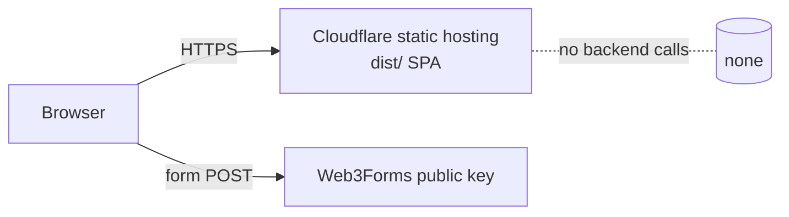
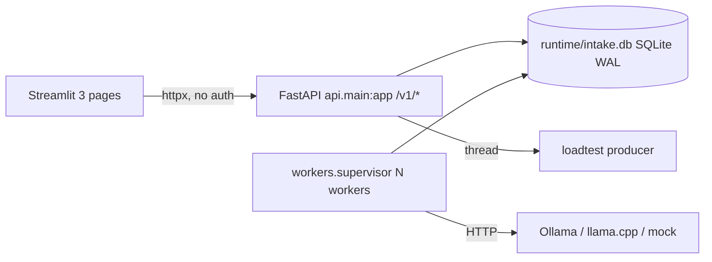
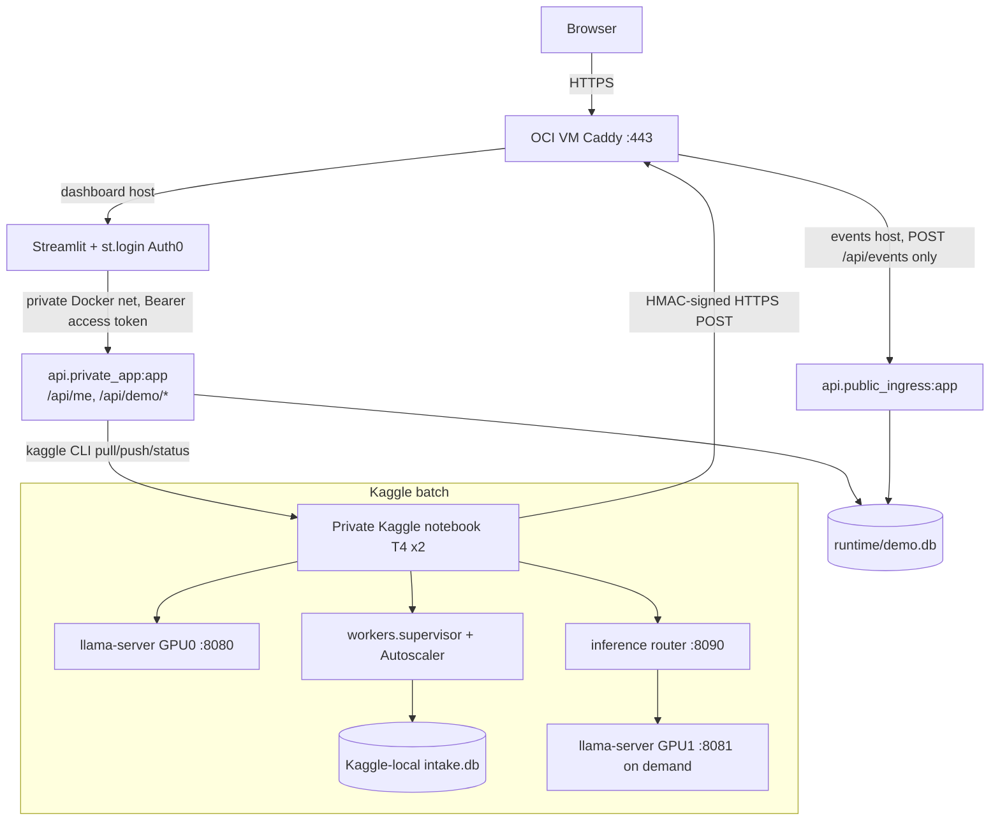
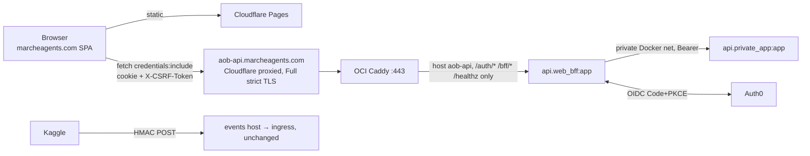

# Phase B: Agent Ops Board (AOB), Streamlit to React Migration Analysis

| | |
|---|---|
| **Status** | Analysis (§0–§12). Phase B2 frontend implementation (simulated adapter only) is recorded in §13. The AOB repository was not changed. |
| **Date** | 2026-11-18 |
| **Frontend baseline** | `marcheagents_front` @ `8c2b4b0` (`main`) |
| **AOB baselines** | **Authoritative:** `agent-ops-board` branch `OCI_Phase1` @ `523c0e194605b3753706103fa0c631c892ba5ac1` (= `origin/OCI_Phase1`, not merged to `main`). For comparison only: `main` @ `b14aebb`. |
| **Method** | We read every Streamlit page, the API client, the FastAPI routers, the auth, event-ingress and launcher modules, the scaling package, and the AOB Phase 1 docs (`docs/01`–`07` on `OCI_Phase1`). The first pass read the branches with `git archive`. The second pass re-read the checked-out `OCI_Phase1` working tree and corrected the document. See **§12 OCI_Phase1 Source Verification**. The AOB repository was not modified. |
| **Verified** | 2026-11-18 against `OCI_Phase1` @ `523c0e1` (clean working tree, HEAD = `origin/OCI_Phase1` after `git fetch`) |

Notation: `AOB[main]:path:line` and `AOB[OCI]:path:line` refer to files in the
`agent-ops-board` repository on `main` and `origin/OCI_Phase1` respectively.
`FE:path` refers to this repository.

---

## 0. Key findings (read first)

1. **Most of the features in scope do not exist on AOB `main`.** On `main`, AOB is a
   three-page Streamlit app (Dashboard, Worker Monitor, Intake Unit Detail) on an
   **unauthenticated** `/v1/*` FastAPI. Auth0, Kaggle, the GPU metrics, worker/GPU
   auto-scaling and the **Live GPU Demo** panel exist only on remote branches. The
   branches form a straight line: `main → kaggle_auth0 → kaggle_scaling → OCI_Phase1`. That
   makes **`OCI_Phase1` a superset of the others, and it is the only correct
   migration baseline.** It must be merged and deployed in AOB before React can rely on it.
2. **In production, the current Streamlit UI shows only the Live GPU Demo panel.** On
   `OCI_Phase1`, `AOB_ENV=production` renders the Live Demo panel and then stops with
   *"Phase 1 production mode: only the private live demo panel is available."*
   (`AOB[OCI]:dashboard/app.py:14-18`). In production, every `/v1/*` route returns 404
   (`AOB_ENABLE_LEGACY_V1=0`), and AOB's own ADR-001 and ADR-004 forbid exposing those
   routes publicly. To keep production behaviour the same, React must do the same thing.
   The legacy Dashboard, Workers, Worker Monitor and Unit Detail views stay **dev-only**.
3. **Kaggle sends AOB aggregated telemetry only.** Inside the Kaggle batch, the workers
   write to a SQLite database local to Kaggle (`/kaggle/working/aob-runtime/intake.db`,
   `AOB[OCI]:scaling/scenario.py:53-63`). AOB receives only these events:
   - lifecycle events
   - `scaling_metrics_snapshot` every 3 s (counts, actual/desired workers, per-GPU memory,
     utilisation and request counts)
   - the final summary

   No per-worker identities, heartbeats, per-unit intents, evidence or step timelines
   reach AOB. As a result, the legacy Workers table, Worker Monitor and Intake Unit Detail
   **cannot show Kaggle runs**. They show only data in the AOB host's own `intake.db`.
   Filling this gap would require changes to the Kaggle runtime, which are out of scope.
4. **No AOB API is designed to be called from a browser.** It has no CORS middleware, no
   cookie session and no CSRF protection. Today the *Streamlit server* holds the Auth0
   access token (`st.user.tokens["access"]`) and sends it as `Bearer` to FastAPI
   (`AOB[OCI]:dashboard/api_client.py:74-104`). React needs a **Backend-for-Frontend
   (BFF)** that does the same job. No BFF exists yet. The MarcheAgents blueprint plans an
   ASP.NET Core BFF, but none has been built, and adding .NET to AOB would introduce a new
   backend framework. **Recommendation:** add the BFF as a new ASGI app *inside AOB, using
   the existing FastAPI framework*. This matches the "Phase 2 React + FastAPI BFF" target
   that AOB's own ADR-002 already names.
5. **All seven `/api/*` endpoints that the Live Demo panel calls can be reused unchanged**
   behind that BFF.
6. **This repository contains no Cloudflare configuration.** There is no
   `wrangler.toml`, `functions/`, `_headers` or `_redirects`. The Cloudflare deployment is
   configured outside the repo, presumably Pages with Git integration. All React work below
   assumes a static SPA build (`npm run build` → `dist/`).
7. **The Kaggle batch does not run `OCI_Phase1`'s scaling code.** The staged notebook cell
   runs `git clone --depth 1 --branch kaggle_scaling` (`AOB[OCI]:kaggle_launcher.py`,
   `render_scaling_cell`). The batch therefore runs whatever `kaggle_scaling` points to at
   run time (`df28f6b` when verified). Its scaling logic matches `OCI_Phase1`. However, it
   does **not** sanitise free-text `message` fields with `safe_text`, while the
   `OCI_Phase1` ingress rejects unsafe text with a 422. A failure event that carries a
   multi-line log tail or URL can be dropped, and the UI then shows `incomplete` instead
   of `failed`. See G14 and §12.
8. **The OCI deployment is documented, not implemented in the repo.** `OCI_Phase1` has no
   Dockerfile, Compose file or Caddyfile. The topology in §1.3 comes from AOB
   `docs/06`–`07`. The three ASGI apps it relies on do exist in code.

---

## 1. Current architecture

### 1.1 MarcheAgents frontend (this repo)



- React 19, React Router 7, Vite 8, Tailwind 4, `lucide-react`. Tests use Vitest +
  Testing Library and Playwright.
- Fully static. `FE:src/lib/apiClient.ts` is a health-check stub (`/api/healthz`) that
  nothing calls in production.
- `/app/*` renders `LiveWorkspacePage`, a locked marketing placeholder. Its copy already
  advertises "2 GPUs", "2 → 8 → 2 auto-scaling", "Live Operations Dashboard".
- The only `VITE_*` variable is `VITE_WEB3FORMS_ACCESS_KEY`, which is public by design.
- Blueprint (`FE:docs/MarcheAgents_Implementation_Blueprint_v2.md` §0, §3.2): the browser
  must never hold OAuth tokens. The `/app/*` routes are served through a BFF with
  `Secure; HttpOnly` cookies and CSRF protection.

### 1.2 AOB `main` (local demo)



### 1.3 AOB `OCI_Phase1` (target Phase 1 deployment, designed but not yet live)



Three FastAPI entry points exist on `OCI_Phase1`:

| ASGI app | Routes | Production |
|---|---|---|
| `api.main:app` (`AOB[OCI]:api/main.py`) | `/v1/*` (gated by `AOB_ENABLE_LEGACY_V1`) and `/api/me`, `/api/demo/*` | **Refuses to start** when `AOB_ENV=production` (lines 26-28) |
| `api.private_app:app` | `/api/me`, `/api/demo/*`; docs/OpenAPI disabled | Private network only |
| `api.public_ingress:app` | `POST /api/events` only; docs/OpenAPI disabled | Public via Caddy, POST only |

`api.main:app` mounts only `demo_api.private_router`, not the ingress router. A local
development setup that needs Kaggle events must also run `api.public_ingress:app`. None of
the apps declares Pydantic `response_model`s. The response shapes in Appendix A are
derived from the dict-building code, not from an OpenAPI schema.

---

## 2. Repository and file inventory

### 2.1 `agent-ops-board`: branches

| Branch | Head | Adds on top of the previous branch |
|---|---|---|
| `main` | `b14aebb` | Streamlit 3 pages, `/v1` API, workers, load test |
| `origin/kaggle_auth0` | `bb7f46e` | Auth0 login gate, `demo_api.py`, `demo_auth.py`, `kaggle_launcher.py`, Live Demo panel v1 |
| `origin/kaggle_scaling` | `df28f6b` | `scaling/` package, GPU/worker auto-scaling, live metrics charts |
| `origin/OCI_Phase1` | `523c0e1` | Split ingress/private apps, event schemas, DTO sanitising, production guards, `docs/01-07` |

### 2.2 `agent-ops-board` (`OCI_Phase1`): files relevant to the migration

| Area | File | Role |
|---|---|---|
| **Streamlit UI** | `dashboard/app.py` | Dashboard page: Live Demo panel, production gate, load-test controls, synthetic message form, live KPIs, workers table, intake-unit table |
| | `dashboard/live_demo.py` | Live GPU Demo panel: start, run select, status, validation events, scaling overview, GPU cards, 4 charts, timeline, summary |
| | `dashboard/pages/worker_monitor.py` | Worker Monitor page |
| | `dashboard/pages/intake_unit_detail.py` | Intake Unit Detail page (evidence highlighting, workflow, handoff) |
| | `dashboard/ui.py` | Formatters, status icons, page chrome, colour-coded "area" cards, navigation |
| | `dashboard/highlight.py` | Evidence span validation and overlap-aware highlighting |
| | `dashboard/auth_gate.py` | Auth0 login gate (`st.login`, `st.user`, `st.logout`) |
| | `dashboard/api_client.py` | **The only path from the UI to data.** httpx calls to `/v1/*` and `/api/*` |
| **API** | `api/main.py` | Legacy dev app (`/v1/*`) and the private router |
| | `api/private_app.py`, `api/public_ingress.py` | Production entry points |
| | `api/queries.py`, `loadtest/metrics.py` | Read models behind `/v1` |
| | `api/response_models.py` | Error-code allowlist |
| | `demo_api.py` | `/api/me`, `/api/demo/*`, `POST /api/events` |
| | `demo_auth.py` | Auth0 JWT verification, whitelist, HMAC event keys |
| | `demo_service.py` | Run lifecycle, phase/result derivation, Kaggle status sync |
| | `demo_scaling.py` | Sanitised read models for `/state`, `/metrics`, `/summary` |
| | `demo_store.py` | `demo.db` (`demo_runs`, `demo_events`), rate limits, single active run |
| | `security/event_schemas.py`, `security/event_text.py` | Strict per-event payload schemas and text sanitising |
| | `security/production_config.py` | Fail-closed startup checks |
| **Kaggle and scaling** | `kaggle_launcher.py` | Pulls the notebook, stages the per-run prelude and scaling cell, pushes, polls status |
| | `kaggle-notebook/`, `notebook-check/` | Notebook metadata and copies |
| | `scaling/bootstrap.py` | Entry point inside the notebook |
| | `scaling/scenario.py` | Orchestrates GPU0, router, supervisor, load, autoscaler, summary |
| | `scaling/autoscaler.py`, `scaling/policy.py`, `scaling/settings.py` | Control loop, pure decisions, thresholds |
| | `scaling/gpu_manager.py` | `llama-server` lifecycle, `nvidia-smi` stats |
| | `scaling/inference_router.py` | `:8090` load balancer, per-GPU counters, unit attribution |
| | `scaling/events.py` | Non-blocking ordered event publisher |
| **Config** | `config.py`, `.streamlit/secrets.toml.example`, `allowed_users.example.json` | Settings and secret templates |
| **Docs** | `docs/01`–`07` | Phase 1 plan, trust boundaries, API reduction matrix, OCI/Compose deployment |

### 2.3 `marcheagents_front`: files relevant to the migration

| File | Relevance |
|---|---|
| `src/app/router.tsx` | Add new `/app/agent-ops/*` routes. Existing routes stay unchanged. |
| `src/app/App.tsx`, `src/components/platform/PlatformHeader.tsx` | Shared shell. No change required. |
| `src/pages/LiveWorkspacePage.tsx` | Existing `/app/*` placeholder. Kept as is. An optional CTA link to the new route needs approval. |
| `src/components/common/ModeBadge.tsx` | Reusable "protected-live" badge |
| `src/lib/apiClient.ts` | Health stub. The AOB client will live in a separate feature module. |
| `package.json` | No charting library yet. One is needed for the 4 line charts (§3.4). |
| `vite.config.ts` | A dev-only proxy will be added for local AOB. |
| `.env.example` | Will document a single public `VITE_AOB_BFF_ORIGIN`. |
| `Dockerfile` | Copies `Caddyfile.local`, which does not exist in the repo. This is a pre-existing issue, out of scope, and noted only. |
| `docs/MarcheAgents_Implementation_Blueprint_v2.md` | BFF/cookie/CSRF principles that this plan follows |

---

## 3. Streamlit UI inventory and React component mapping

### 3.1 Where each requested capability lives today

| Requested capability | Streamlit location | Data source | Available in production? |
|---|---|---|---|
| **Dashboard** | `dashboard/app.py` | `/v1/dashboard`, `/v1/intake-units` | No (dev only) |
| **Detail** | `dashboard/pages/intake_unit_detail.py` | `/v1/intake-units/{id}`, `/steps` | No (dev only) |
| **Workers** | `app.py` workers area + `pages/worker_monitor.py` | `/v1/dashboard.workers`, `/v1/workers*` | No (dev only) |
| **Live Demo** | `dashboard/live_demo.py` | `/api/demo/*` | **Yes** |
| **GPU metrics** | `live_demo._gpu_card`, `_live_metrics` | `/api/demo/{id}/state`, `/metrics` | **Yes** |
| **Agent execution** | Kaggle: `live_demo` status/phase + validation events. Local: Worker Monitor "Current execution" and Unit Detail "Workflow" | `/api/demo/{id}/status`, `/validation`; `/v1/workers/{id}`, `/v1/intake-units/{id}/steps` | Kaggle part yes; local part dev only |
| **Auto-scaling** | `live_demo._scaling_overview`, `_timeline`, `_summary`, Workers chart | `/api/demo/{id}/state`, `/metrics` | **Yes** |

### 3.2 Streamlit internals that are *not* HTTP APIs and need React or BFF equivalents

| Streamlit internal | Used for | React / BFF equivalent |
|---|---|---|
| `st.login("auth0")`, `st.user`, `st.user.tokens["access"]`, `st.logout()` | OIDC login, user name, token, logout | BFF `/auth/login`, `/auth/callback`, `/auth/logout`, `/bff/session` (§5.4) |
| `.streamlit/secrets.toml` `[auth]` (client secret, cookie secret, audience) | OIDC client config | BFF server-side secrets (never in `VITE_*`) |
| `st.fragment(run_every=…)` | Polling refresh | `usePolling(fn, intervalMs \| null)` hook |
| `st.rerun()` / `st.rerun(scope="app")` | Re-evaluate controls when run state changes | React state transitions / refetch |
| `st.session_state` (`demo_run`, `unit_id`, `worker_id`, …) | Selection memory | Component state + URL params |
| `st.query_params`, `st.switch_page` | Deep links `?worker_id=`, `?unit_id=` | Router paths `/app/agent-ops/workers/:workerId`, `/units/:unitId` |
| `st.dataframe(on_select="rerun")` | Row click → open detail | Clickable, keyboard-accessible table rows |
| `config.AOB_ENV` read in-process by `app.py` | Production gate | Build-time gate (§3.6) |
| `api_client.API_URL` embedded in the attachment link | Browser downloads straight from the API | Dev only, through the Vite proxy. No production route. |
| `ui.fmt_ts` → `datetime.fromtimestamp` | **Server** local time zone | Browser local time zone. This is a visible difference that needs a decision (§10). |

### 3.3 Proposed React structure (new files only)

```
src/features/agent-ops/
  api/aobClient.ts          fetch wrapper: BFF origin, credentials:'include', CSRF header, ApiError{status,detail}
  api/types.ts              DTO interfaces (Appendix A)
  api/legacyClient.ts       /v1/* client, dev-only (§3.6)
  hooks/usePolling.ts       interval + AbortController; null interval = no polling
  hooks/useAobSession.ts    GET /bff/session
  lib/format.ts             fmtTs, fmtDur, fmtAge, na    (ports of ui.py / live_demo.na)
  lib/status.ts             STATUS_ICON map + <StatusBadge>
  lib/highlight.ts          validSpans, segmentSpans → React nodes (no innerHTML)
  lib/chartFrames.ts        port of live_demo.chart_frames
  components/…              (tables below)
src/pages/agent-ops/
  AgentOpsDashboardPage.tsx /app/agent-ops
  WorkerMonitorPage.tsx     /app/agent-ops/workers/:workerId   (dev-only)
  IntakeUnitDetailPage.tsx  /app/agent-ops/units/:unitId       (dev-only)
```

These are UI ports of dashboard formatting and highlighting logic. No backend Python code
is copied.

### 3.4 Dashboard page (`dashboard/app.py` + `live_demo.py` + `auth_gate.py`)

Rendering order matches Streamlit's top-to-bottom order.

| # | Streamlit element (source) | React component | Data / behaviour to preserve |
|---|---|---|---|
| 1 | `ui.page_header`: title "Agent Ops Board", caption "🧪 Synthetic Demo — synthetic, non-confidential content. No account updates or external replies." | `AobPageHeader` | Same text |
| 2 | `auth_gate.require_login` states | `AobAuthGate` | Six blocking states, in this order. (a) Production without `[auth]` config: error *"Authentication is required in production, but auth config is missing."* plus **Log out**. (b) Not logged in: info *"Private demo: invited users only. There is no public sign-up."* plus **Log in**. (c) Logged in but no access token: error *"No API access token was issued. …"* plus **Log out**. (d) `/api/me` 403: *"This account is not on the demo whitelist."* plus **Log out**. (e) 401: warning *"Your session expired or the token is invalid. Log out and sign in again."* plus **Log out**. (f) Any other error (including 503 *"Auth0 is not configured on the server"* and *"API unreachable …"*): show the message plus **Log out**. In React, (a) and (c) become BFF-side configuration errors. Signed in: the sidebar shows *"Signed in as {name \|\| email \|\| 'user'}"* plus **Log out**. This becomes a header strip. |
| 3 | `live_demo.render` bordered container: "Live GPU demo" plus caption about Kaggle batch | `LiveDemoPanel` | Same caption. If `/runs` fails, show the error and render nothing else. |
| 3a | Mode radio (`light` "Light — 2 workers / 1 GPU", `high_concurrency` "High Concurrency — 2→8→2 workers / 1→2→1 GPU"), "Synthetic tasks" select 50/100/150 (default 100, disabled for light, help *"High Concurrency only; Light always uses 10."*), **▶ Start Live Demo** | `LiveDemoControls` | All three are disabled while **one of the current user's runs** (from `/runs`) is `submitting/queued/running`. Another user's active run does **not** disable them; the server's single global run lock then returns 409. POST `/start` sends `{mode}` for light and `{mode, units}` for high concurrency. Sending `units` with light returns 422. 409: *"A demo is already queued or running."* 429: show the API detail (*"Please wait before starting another demo."* or *"Daily demo limit reached."*); `Retry-After` is also set. Other errors: *"Start failed: …"*. After a start, select the new `run_id` from the 202 body. |
| 3b | "Run" selectbox | `RunSelector` | Shows raw `run_id` strings from `/runs` (owner's last 20, newest first). Default is the newest. Keep the selection if it still exists. |
| 3c | Run panel fragment (`run_every=3` only if the selected run was active when the page rendered) | `LiveRunPanel` + `usePolling(3000 \| null)` | Each tick calls `/status`, then `/state`, then `/metrics` (only if `state.snapshot`), then `/validation`. If any of the first three fail, show the error. When status leaves the active set, rerun the whole app, which refetches runs and re-enables the controls. |
| 3d | Status line: icon + `STATUS` + description (status map; `running` uses `PHASE_TEXT[phase]`; `complete` uses `RESULT_TEXT[result]`); `error_code` shown as a raw code in an error box | `RunStatusLine` | Same maps (`live_demo.py`: `PHASE_TEXT`, `RESULT_TEXT`, `status_config` in `_run_panel`) |
| 3e | "Validation events" table (Received, Event, Status `passed`/`failed`/"—") | `ValidationEventsTable` | `/validation`. Empty state: *"No events received yet."* |
| 3f | Stop here if `scaling_status` is null and the timeline is empty | — | Same condition |
| 3g | "Scaling overview": warning *"Telemetry delayed — last event {n}s ago. Values below may be stale."*; 5 metrics (Actual / desired workers, Pending, Running, Completed x/(`total` or `state.units`), Failed); "Scaling state: X · 🔴 LIVE" | `ScalingOverview` | `state.snapshot`, `telemetry_delayed`, `seconds_since_last_event`, `live`, `scaling_state` (`BASELINE`/`SCALE_OUT`/`SCALED_OUT`/`DRAINING`) |
| 3h | GPU 0 / GPU 1 cards: `state` · port; Memory used (`{:,} MB`), Utilization `{}%`, Units processed, In flight | `GpuCard` ×2 | `snapshot.gpu0/gpu1` (`state` ∈ `STOPPED`/`STARTING`/`READY`/`DRAINING`/`FAILED`), `units_by_gpu`, `inflight_by_gpu`. Show "N/A" for missing values. **Port is always N/A today** because `_safe_gpu` drops it (G9). |
| 3i | Unattributed-units warning | `ScalingOverview` | `snapshot.unattributed_units > 0` |
| 3j | "Live metrics": caption *"Seconds since the first snapshot; every point is a real reading from the Kaggle batch."* plus up to 4 line charts in a 2-column grid, height 310: Queue depth (Pending, Running), Workers (Actual workers, Desired workers), GPU utilization % (GPU 0, GPU 1), GPU memory used (MB) (GPU 0, GPU 1) | `LiveMetricsCharts` (chart library, e.g. `recharts`; dependency approval needed) | `/metrics.points`, x = `t` seconds. Hide a series that is all null. Hide a chart with no series. Hide the whole section when no chart remains. Keep gaps for null points. Stack to 1 column on narrow screens. |
| 3k | "Scaling event timeline" table (Time, Event, What happened) | `ScalingTimeline` | `state.timeline[].label` (already sanitised server-side). Empty: *"No scaling events yet."* |
| 3l | "Run summary and evidence": verdict (`SCALING_TEXT`) "— separate from the model validation result above"; failure error `"{error_code} during `{phase}`: {message}"`; reasons warning *"Not a full pass: …"*; 13-row Measure/Value table | `RunSummary` | `state.summary`, `state.failure`. Same row labels and formats (`live_demo._summary`). Without a summary: *"The summary appears once the scaling experiment finishes."* |
| 4 | **Production gate**: info *"Phase 1 production mode: only the private live demo panel is available."* and stop | `ProductionGateNotice` | Rendered in every production build (§3.6) |
| 5 | Controls container: Scenario select, Units 1-5000 (350), Workers 1-8 (2), Arrival window 0-7200 (600, disabled for burst), Deadline 1-7200 (600), fault checkbox, **▶ Start Load Test** / **■ Stop Test** | `LoadTestControls` (dev-only) | Disabled while running. POST `/v1/load-tests`, `/v1/load-tests/{id}/stop`. Toast "Started {id}". |
| 6 | Expander "Submit one synthetic message (optional)": Channel, Subject, Body (prefilled), Submit | `SubmitMessageForm` (dev-only) | POST `/v1/messages`. `messages[]` for chat/voice. Success *"Queued {unit_id}"*. |
| 7 | **Area "dashboard"** (indigo `#6366f1`), polled at 2 s while running and 5 s when idle | `AreaCard` + `RunProgressSection` | `/v1/dashboard`: model banner (SIMULATED warning), run line, progress bar, deadline error, acceptance pass/fail, stop-requested warning, 6 count metrics, manual-review warning, 6 KPIs (Completion, Completed/min with required-rate help, P50, P95, Queue depth, Est. remaining), error-code warning (LLM_TIMEOUT hint), retry caption |
| 8 | **Area "workers"** (emerald `#10b981`) | `WorkersTable` (dev-only) | `snapshot.workers`: Worker, Status, Health, Current Unit, Current Step, Attempt, Step elapsed, Heartbeat. Clicking a row opens the Worker Monitor. With no workers, show the supervisor-not-running error or the no-registration warning. **Do not render `db_path`/`pid` beyond dev** (see §5.3). |
| 9 | **Area "units"** (amber `#f59e0b`), polled at 5 s while running and 15 s when idle | `IntakeUnitsTable` (dev-only) | Filters: Unit ID contains, Channel, Status, Worker, Intent, Created window. Page size 25/50/100, Page, "Current run only". Caption "N unit(s) · page x of y". Columns: Unit ID, Channel, Subject/preview, Status, Worker, Current Step, Duration. Clicking a row opens Unit Detail. |

### 3.5 Worker Monitor and Intake Unit Detail (dev-only)

| Streamlit element | React component | Notes |
|---|---|---|
| "← Back to Dashboard"; worker select fallback when the id is unknown | `BackLink`, `WorkerPicker` | From `/v1/workers` |
| Fragment 2 s: 6 stats (PID / host, Health, State, Last heartbeat, Lease expiry "in Ns", Current unit) | `WorkerHeaderStats` | `/v1/workers/{id}` |
| UNHEALTHY/OFFLINE warning; BACKOFF info; "Open {unit} →" | `WorkerStateAlerts` | |
| "Current execution" / "Last execution": 6 stats, model caption, open button, step strip | `ExecutionPanel`, `StepStrip` | Caption *"Stage indicator only: token generation has no known completion percentage."* |
| "Events and retries" table (height 360) + up to 10 problem expanders with retry details | `WorkerEventsTable`, `ProblemEventList` | `/v1/workers/{id}/events?limit=100` |
| Unit Detail: Back; Unit ID input fallback; fragment 2 s only while PENDING/RUNNING/WAITING_RETRY | `IntakeUnitDetailPage` + `usePolling(2000 \| null)` | `/v1/intake-units/{id}` + `/steps` |
| 6 stats; source refs caption; assigned worker button; error | `UnitHeaderStats` | |
| "Intents and evidence": pills `All` + labels; colour legend | `IntentPills`, `IntentLegend` | Palette from `highlight.py` |
| "Original input": segment header (kind · speaker · id · timestamp), highlighted body | `SourceSegment` + `lib/highlight.ts` | Port `valid_spans` and the overlap split. **Render React `<mark>` nodes; never `dangerouslySetInnerHTML`.** Multi-label spans use a striped gradient and a tooltip. |
| Attachments 📎 download links | `AttachmentList` | Dev-only through the proxy (no production route, see §5.3) |
| Evidence table (Intent, Verbatim evidence, Source, Offsets, Check ✅/⚠️) + claims caption | `EvidenceTable` | |
| Extracted entities; Output validation (4 stats + warnings) | `EntitiesTable`, `ValidationStats` | |
| Workflow: attempt select; step strip; "Audit events (n)" expander | `WorkflowPanel`, `AuditEventsTable` | |
| "Mock downstream handoff" 4 stats + last error + note | `HandoffPanel` | |

### 3.6 Production vs development gating

- **Production (Cloudflare build):** render items 1-4 of §3.4 only. This matches
  `AOB_ENV=production` Streamlit exactly. Legacy components are excluded at build
  time with `import.meta.env.DEV && import.meta.env.VITE_AOB_LEGACY_V1 === '1'`. No
  `/v1` URL ships in the production bundle.
  - *Verified difference:* in Streamlit, only `app.py` has the production gate. The
    `pages/worker_monitor.py` and `pages/intake_unit_detail.py` pages are still listed in
    the production sidebar. When opened, they show an API error because
    `api.private_app` has no `/v1` routes. Omitting these routes from the React
    production build removes a broken link. It does not remove working functionality.
- **Development:** `npm run dev` with `VITE_AOB_LEGACY_V1=1` renders the full legacy
  dashboard and the two detail pages against a local `uvicorn api.main:app`
  (`AOB_ENV=development`), using a Vite `server.proxy` for `/v1`. This matches local
  Streamlit (`login_required()` is false and only legacy sections render; the Live Demo
  needs the BFF).

---

## 4. API endpoint inventory

### 4.1 Endpoints and how Streamlit uses them

| Method | Path | Defined at | Auth | Called by Streamlit | Production on `OCI_Phase1` | React reuse |
|---|---|---|---|---|---|---|
| GET | `/v1/dashboard` | `AOB[OCI]:api/main.py:70` | **none** | `app.py` (header + live + workers) | 404 | Dev only, unchanged |
| GET | `/v1/workers` | `api/main.py:85` | none | `worker_monitor.py` (picker) | 404 | Dev only |
| GET | `/v1/workers/{worker_id}` | `api/main.py:92` | none | `worker_monitor.py` | 404 | Dev only |
| GET | `/v1/workers/{worker_id}/events` | `api/main.py:102` | none | `worker_monitor.py` | 404 | Dev only |
| GET | `/v1/intake-units` | `api/main.py:109` | none | `app.py` units table | 404 | Dev only |
| GET | `/v1/intake-units/{unit_id}` | `api/main.py:121` | none | `intake_unit_detail.py` | 404 | Dev only |
| GET | `/v1/intake-units/{unit_id}/steps` | `api/main.py:131` | none | `intake_unit_detail.py` | 404 | Dev only |
| GET | `/v1/intake-units/{unit_id}/handoff` | `api/main.py:147` | none | client fn exists, **unused** (detail uses `unit.handoff`) | 404 | Not needed |
| GET | `/v1/intake-units/{unit_id}/attachments/{attachment_id}` | `api/main.py:157` | none | direct browser link | 404 | Dev only |
| POST | `/v1/load-tests` | `api/main.py:179` | none | `app.py` Start | 404 | Dev only |
| GET | `/v1/load-tests` | `api/main.py:193` | none | unused | 404 | Not needed |
| GET | `/v1/load-tests/{run_id}` | `api/main.py:202` | none | unused | 404 | Not needed |
| POST | `/v1/load-tests/{run_id}/stop` | `api/main.py:217` | none | `app.py` Stop | 404 | Dev only |
| POST | `/v1/messages` | `api/main.py:241` | none | `app.py` form | 404 | Dev only |
| GET | `/api/me` | `AOB[OCI]:demo_api.py:67` | Auth0 JWT + whitelist | `auth_gate.py` | Private | **Reuse unchanged** (BFF) |
| POST | `/api/demo/start` | `demo_api.py:77` | JWT + whitelist | `live_demo.render` | Private | **Reuse unchanged** |
| GET | `/api/demo/runs` | `demo_api.py:94` | JWT + whitelist (owner filter) | `live_demo.render` | Private | **Reuse unchanged** |
| GET | `/api/demo/{run_id}/status` | `demo_api.py:100` | JWT + owner (404 otherwise) | run panel | Private | **Reuse unchanged** |
| GET | `/api/demo/{run_id}/state` | `demo_api.py:106` | JWT + owner | run panel | Private | **Reuse unchanged** |
| GET | `/api/demo/{run_id}/metrics` | `demo_api.py:112` | JWT + owner | run panel | Private | **Reuse unchanged** |
| GET | `/api/demo/{run_id}/summary` | `demo_api.py:117` | JWT + owner | unused (data duplicated in `/state`) | Private (doc 03 plans removal) | Not needed |
| GET | `/api/demo/{run_id}/validation` | `demo_api.py:122` | JWT + owner | `_events_table` | Private | **Reuse unchanged** |
| POST | `/api/events` | `demo_api.py:160` | HMAC per-run key | — (Kaggle only) | Public ingress | **Never from browser** |

All Streamlit data access goes through `dashboard/api_client.py`. The UI never reads
SQLite or calls the model directly, so the HTTP inventory above is complete.

### 4.2 Response facts that matter for React

- Timestamps are **epoch seconds (float)**. `server_time` is returned by `/v1/*` for
  lease and age calculations.
- `/api/me` = `{user_id, can_start_demo: true}`. There is no name or email.
- `/api/demo/start` returns **202** with a `run_view` (`status: "submitting"`). Defaults:
  light = 10 units, high concurrency = 100.
- `/api/demo/runs` = `{items: run_view[]}`.
- `/api/demo/{id}/status` = `run_view` + `{phase, last_event_type, last_event_at,
  result, model, event_count, mode, units, scaling_status}`. `model` is the constant
  `"Qwen3-4B-Instruct-2507"`.
- `/api/demo/{id}/state` = `run_view` + `{mode, units, scaling_status, live,
  scaling_state, snapshot, snapshot_received_at, seconds_since_last_event,
  telemetry_delayed, plan, summary, failure, timeline[]}`. All fields are allowlisted and
  sanitised by `demo_scaling._safe_*`. `mode` and `units` here come from the
  `scaling_demo_started` plan when one exists, and from the run row otherwise.
- `/api/demo/{id}/metrics` = `{points: [...]}`. It keeps the **last** 600 snapshots
  (`MAX_METRIC_POINTS`) out of at most 1000 events per run, in receive order. `t` is
  measured from the first *retained* point, so the x axis restarts if older points are cut.
- `/api/demo/{id}/validation` = `{items: [{id, received_at, event_type, status}]}`, limited
  to the 8 validation event types. `status` is only `passed`, `failed` or `null`.
- `/api/demo/{id}/summary` = `{scaling_status, summary, failure}` (unused by Streamlit).
- `run_view.error_code` is one of a closed allowlist (`api/response_models.py`):
  `KAGGLE_SUBMISSION_FAILED`, `KAGGLE_RUN_TIMEOUT`, `KAGGLE_SUBMISSION_TIMEOUT`,
  `KAGGLE_REPORTED_FAILURE`, `LAUNCHER_ERROR`, `UNKNOWN_ERROR`, or `null`. Launcher errors
  read *"Kaggle push failed: …"* or *"Kaggle pull failed: …"*. These do not contain the
  `"kaggle kernels push failed"` needle, so in practice they surface as `UNKNOWN_ERROR`.
- `run_view.kaggle_status` is the **mapped** value (`queued`, `running`, `complete`,
  `failed`, `cancelled`) or `null`. It is never the raw Kaggle enum.
- Error bodies: FastAPI `{"detail": "..."}`. 429 also carries a `Retry-After` header. The
  Pydantic 422 `detail` is an array, not a string.
- **Reading has side effects, and so does starting.** `owned_run` calls
  `demo_service.sync_run`, which may run `kaggle kernels status` synchronously, at most
  every 15 s per active run, with a 60 s CLI timeout. `/api/demo/runs` calls `sync_run` for
  every listed run. `/api/demo/start` forces a sync of all active runs first.
- **Streamlit's client timeout is 10 s** (`dashboard/api_client.py`). A slow Kaggle CLI
  call therefore shows *"API unreachable at … (ReadTimeout)"* in Streamlit today. For
  strict parity React would use 10 s. A longer timeout of at least 65 s is a deliberate
  improvement and needs a decision (B0).

---

## 5. Authentication and security boundaries

### 5.1 Mechanisms that exist today

| Mechanism | Where | Details |
|---|---|---|
| **None** | AOB `main`, all `/v1/*` | README: "No authentication/RBAC". `OCI_Phase1` keeps `/v1` unauthenticated but disabled in production. |
| Streamlit OIDC login | `AOB[OCI]:dashboard/auth_gate.py`, `.streamlit/secrets.toml.example` | Auth0 Regular Web App, Universal Login, sign-ups disabled. `client_secret` and `cookie_secret` live in Streamlit secrets. `expose_tokens=["access"]`; `audience` = AOB API identifier. Login is forced in production. |
| Session | Streamlit's own signed identity cookie | Managed by Streamlit; opaque to FastAPI |
| API token | Auth0 **access token** (RS256 JWT), held **server-side** in Streamlit, sent as `Authorization: Bearer` | ID token must never be used for the API (README) |
| Token verification | `AOB[OCI]:demo_auth.py:37-48` | JWKS from `https://{AUTH0_DOMAIN}/.well-known/jwks.json`. Checks RS256, `aud`, `iss`, `exp`, `sub`, 10 s leeway. Returns 503 if not configured. |
| Authorisation | `demo_auth.py:51-65` | `allowed_users.json` re-read on every request. Fails closed. Requires `enabled: true`. |
| Ownership | `demo_api.owned_run` | Another user's run returns **404** |
| Abuse limits | `demo_store.create_run` | One active run globally (409). Per-user cooldown `AOB_DEMO_MIN_INTERVAL` (config default **100 s**) → 429 *"Please wait before starting another demo."* with `Retry-After` = remaining seconds. Per-user cap `AOB_DEMO_MAX_RUNS_PER_DAY` (config default **35**) over a **rolling 24 h window** → 429 *"Daily demo limit reached."* with `Retry-After: 3600`. The README says 300 s / 5, so `config.py` is authoritative. |
| Kaggle → AOB | `demo_auth.run_event_key/verify_event`, `demo_api.receive_event`, `demo_store.add_event` | Per-run key `HMAC(EVENT_SECRET, "run:{id}:v:{ver}")`. Signature `sha256=HMAC(key, "{ts}.{body}")`. ±300 s skew. 64 KB limit. JSON only. Strict per-type schema. Run must be active, not expired, not revoked. Dedupe on `(run_id, event_id)`. Limit 1000 events per run. |
| Kaggle CLI credentials | API host only (`~/.kaggle` or env) | Never in Streamlit or the browser |
| Production guards | `security/production_config.py`, `api/main.py:26-28` | Startup fails without Auth0 config, whitelist, event secret and an HTTPS events URL. The legacy app refuses to start in production. |
| CORS / CSRF / cookie auth in FastAPI | — | **None exist.** |
| MarcheAgents frontend | — | No auth. Blueprint requires BFF + `HttpOnly` cookie + CSRF for `/app/*`. |

### 5.2 Target trust boundaries for React

| Boundary | Allowed | Forbidden |
|---|---|---|
| Browser → Cloudflare (`marcheagents.com`) | Static SPA assets | Any secret in `VITE_*` or in the bundle |
| Browser → AOB BFF | Top-level navigation to `/auth/*`. `fetch` with the session cookie to an **allowlisted** set of `/bff/*` routes. CSRF header on state-changing methods. | Bearer tokens in JS. Access to `/api/demo/*`, `/v1/*`, `/api/events`, `/docs`. |
| BFF → Auth0 | Authorization Code + PKCE as a confidential client. Token exchange on the server. | Returning tokens to the browser |
| BFF → Private Control Plane | Server-side `Bearer` access token over the private Docker network (same as Streamlit today) | Public exposure of the control plane |
| Kaggle → Event Ingress | Unchanged | Any change in this phase |

### 5.3 Data that must never reach the browser

- Auth0 client secret, Streamlit/BFF cookie secret, and the **access, refresh and ID
  tokens**. Display claims (name or email) may be sent; raw tokens may not.
- `AOB_EVENT_SECRET`, per-run event keys, Kaggle credentials, `AOB_KAGGLE_NOTEBOOK_REF`,
  `AOB_REPO_URL`, `AOB_EVENTS_URL`.
- Internal topology and process data: `model.url`, `supervisor.db_path`,
  `supervisor.pid`, worker `pid`/`host` and other fields from `/v1/dashboard` and
  `/v1/workers`. These stay in dev-only views. If a production version is ever needed,
  it requires new sanitised endpoints (G3).
- Attachments: `/v1/.../attachments/...` has no authorisation and must not be exposed.

### 5.4 Proposed BFF (new FastAPI ASGI app inside AOB, e.g. `api/web_bff.py`)

This is the minimum route set. It is an allowlist, not a generic proxy.

| Method | Route | Purpose | Upstream |
|---|---|---|---|
| GET | `/auth/login?return_to=` | Starts Auth0 Code + PKCE. `return_to` is checked against the allowlisted origin and path prefix. | Auth0 `/authorize` (`audience` = AOB API) |
| GET | `/auth/callback` | Exchanges the code, creates a server-side session, sets the cookie, redirects | Auth0 `/oauth/token` |
| POST | `/auth/logout` | CSRF-protected. Deletes the session, then redirects to Auth0 logout and back to `https://marcheagents.com/app/agent-ops`. | Auth0 `/v2/logout` |
| GET | `/bff/session` | `{authenticated, user:{display_name}, can_start_demo, csrf_token}`. `can_start_demo` is passed through from `/api/me`. `display_name` comes from ID-token claims held by the BFF (`name`, then `email`, then `"user"`, the same fallback as `auth_gate`). Maps 401/403/503 from `/api/me` to the same UI states as `auth_gate`. | `/api/me` |
| GET | `/bff/aob/demo/runs` | Passthrough | `/api/demo/runs` |
| POST | `/bff/aob/demo/start` | CSRF + Origin check. Passes `Retry-After` through. | `/api/demo/start` |
| GET | `/bff/aob/demo/{run_id}/status` · `/state` · `/metrics` · `/validation` | `run_id` regex `^run-[0-9a-f]{16}$` | `/api/demo/{run_id}/…` |
| GET | `/healthz` | Liveness only (no version or config) | — |

Session design:

- Opaque random ID in the cookie
  `__Host-aob_session; Secure; HttpOnly; SameSite=Lax; Path=/`.
- Tokens stored encrypted in a server-side table, for example in AOB's SQLite.
- Idle timeout (for example 30 min) and absolute timeout (for example 8 h). The session ID
  rotates on login.
- Refresh tokens are optional. Without them, an expired access token returns 401 and
  shows the "session expired" state, which matches Streamlit behaviour.

---

## 6. Proposal: secure access from the Cloudflare React app to AOB

### 6.1 Recommended: Option A, AOB-hosted FastAPI BFF on a same-site subdomain



Hostnames are placeholders. The design works as follows:

- **Same-site cookie.** `marcheagents.com` and `aob-api.marcheagents.com` share a
  registrable domain, so a host-only `SameSite=Lax` cookie is sent on the SPA's
  credentialed `fetch`. This is not affected by third-party-cookie blocking.
- **CORS, BFF only.** Set `Access-Control-Allow-Origin: https://marcheagents.com` (an
  exact match plus an explicit preview-origin allowlist if needed) and
  `Access-Control-Allow-Credentials: true`. Allowed methods are GET and POST, and the only
  allowed custom header is `X-CSRF-Token`. Never use `*`. The private API and ingress get
  no CORS headers.
- **CSRF.** A synchronizer token from `/bff/session` is sent as `X-CSRF-Token` on POST. The
  BFF also checks `Origin` and `Sec-Fetch-Site`. `SameSite` alone is not enough because
  sibling subdomains are same-site.
- **Login is top-level navigation** (`window.location.assign(BFF + '/auth/login?return_to=…')`),
  not `fetch`, so Auth0 Universal Login works normally.
- **Edge hardening:**
  - Caddy routes only `/auth/*`, `/bff/*` and `/healthz` on the BFF host and returns 404
    for everything else.
  - Restrict OCI 443 to Cloudflare ranges or use Authenticated Origin Pulls, if the BFF
    host is Cloudflare-proxied.
  - Add a Cloudflare `_headers` file with a CSP:
    `connect-src 'self' https://aob-api.marcheagents.com https://api.web3forms.com; frame-ancestors 'none'`.
    The Web3Forms endpoint must stay allowed so the existing contact form keeps working.
- **Auth0 configuration:** reuse the existing Regular Web App. Add the BFF callback and
  logout URLs; the audience and the `allowed_users.json` whitelist stay unchanged.
- **Frontend configuration:** one public build variable, `VITE_AOB_BFF_ORIGIN`. It is
  not a secret.
- **Fit with the constraints:** no new backend framework (FastAPI). No Python in the
  frontend repo. `/api/demo/*`, the ingress, scaling and the launcher are unchanged.
  Tokens stay server-side, as `auth_gate` and AOB ADR-002 require.

### 6.2 Alternatives considered

| Option | Description | Verdict |
|---|---|---|
| B | Cloudflare Pages Function or Worker proxies `marcheagents.com/api/aob/*` to the AOB BFF (same origin, no CORS) | Viable follow-up. It adds edge code to this repo and needs origin authentication (Access service token or mTLS). Session and CSRF are still handled by the AOB BFF. |
| C | Auth0 SPA SDK in React with direct `Bearer` calls to the private API | **Rejected.** Puts tokens in the browser, exposes the private control plane publicly, and breaks the blueprint and ADR-002. |
| D | ASP.NET Core BFF from the MarcheAgents blueprint | **Rejected for Phase B.** Adds a new backend framework. Can front AOB later if the platform BFF is built. |
| E | Embed Streamlit in an iframe | **Rejected.** Not a migration, and breaks `frame-ancestors` and cookie isolation. |

---

## 7. Live metrics data flow (Kaggle → AOB → UI)

```mermaid
sequenceDiagram
  participant AS as Autoscaler.tick (every 2 s, in Kaggle)
  participant PUB as EventPublisher (thread)
  participant EM as aob_emit (notebook prelude)
  participant IN as Event Ingress POST /api/events
  participant DB as demo.db demo_events
  participant CP as Private API /state, /metrics
  participant UI as Streamlit (today) / BFF→React (target)
  AS->>AS: queue counts (Kaggle intake.db), live PIDs, nvidia-smi, router stats
  AS->>PUB: publish("scaling_metrics_snapshot", snapshot) every 3 s
  PUB->>EM: ordered, coalesces to ≤5 pending snapshots, ≤900 sent
  EM->>IN: HTTPS POST + X-AOB-Timestamp + X-AOB-Signature (3 tries, 15 s timeout)
  IN->>IN: size ≤64 KB, JSON, HMAC, envelope + _SnapshotPayload schema
  IN->>DB: tx: run active/not expired/not revoked → INSERT OR IGNORE; run→running
  UI->>CP: poll every 3 s while run active
  CP->>DB: latest snapshot + all snapshots (≤600) → _safe_snapshot
  CP-->>UI: state.snapshot (cards/metrics) · metrics.points (charts)
```

| Snapshot field (Kaggle) | Source in Kaggle | Exposed by | UI element |
|---|---|---|---|
| `pending`, `running`, `completed`, `failed`, `total` | `QueueReader.counts()` over the Kaggle-local `intake_jobs` | `/state.snapshot`, `/metrics.points` | Overview metrics; "Queue depth" chart |
| `actual_workers` | Live worker PIDs with fresh heartbeats | both | "Actual / desired"; "Workers" chart |
| `desired_workers` | Autoscaler decision | both | same |
| `scaling_state` | `BASELINE / SCALE_OUT / SCALED_OUT / DRAINING` | `/state` | "Scaling state" |
| `gpu0/gpu1.{state, memory_used_mb, utilization_pct}` | `LlamaInstance.state` + `nvidia-smi` | both (port is dropped) | GPU cards; GPU charts |
| `requests_by_gpu`, `inflight_by_gpu`, `units_by_gpu`, `unattributed_units` | Inference router counters + `X-AOB-Unit-ID` attribution | `/state` (requests also in `/metrics`) | GPU cards; warning |
| `gpu_instances_ready` | Count of READY instances | `/metrics` | — (not charted) |
| `oldest_pending_seconds`, `estimated_drain_seconds`, `failed_by_gpu` | Autoscaler | **Dropped** by `_safe_snapshot` | — |

Derived server-side:

- `live` = run active and `scaling_status == running`.
- `telemetry_delayed` = live and more than 30 s since the last event.
- `t` = seconds since the first **retained** snapshot (last 600), by **server receive
  time**. Client timestamps are never used for ordering.

**Legacy (local) flow, dev only:** `/v1/dashboard` computes `run_metrics` live from the
host's `intake.db`. The Streamlit page polls it every 2 s while a run is running and every
5 s when idle.

---

## 8. GPU and worker auto-scaling data flow

```mermaid
sequenceDiagram
  participant U as User (React)
  participant BFF
  participant CP as Private API
  participant L as kaggle_launcher (API host)
  participant K as Kaggle batch
  participant IN as Ingress
  U->>BFF: POST /bff/aob/demo/start {mode, units}
  BFF->>CP: POST /api/demo/start (Bearer)
  CP->>CP: create_run: single active run, cooldown, daily cap → run-xxxxxxxxxxxxxxxx "submitting"
  CP-->>U: 202 run_view
  CP->>L: background submit_run
  L->>K: kernels pull → stage (prelude: AOB_RUN_ID, mode, units, EVENTS_URL, per-run key, aob_emit) → harden Step 6 → append scaling cell (git clone --branch kaggle_scaling) → kernels push --accelerator T4
  L->>CP: run "queued" (push accepted ≠ GPU ready)
  K->>IN: notebook_started … model_validation_completed (validation phase)
  K->>K: bootstrap.run → GPU0 llama :8080 → router :8090 → supervisor (2 workers) → burst load
  loop every 2 s
    K->>K: policy.worker_target / gpu1_start_reason / gpu1_should_stop
  end
  K->>IN: scaling_demo_started, worker_scaling_requested/completed, gpu_instance_starting/ready/failed/draining/stopped, inference_route_changed, scaling_controller_error, scaling_metrics_snapshot (3 s), scaling_demo_completed | scaling_demo_failed
  U->>BFF: poll status/state/metrics (3 s)
  BFF->>CP: GET … → sync_run (kaggle kernels status ≤ every 15 s; 3 h timeout)
```

**Policy** (`AOB[OCI]:scaling/policy.py`, `scaling/settings.py`). These are demo
thresholds and must not change.

| Mode | Units | Workers | GPUs | Arrival | Timeout |
|---|---|---|---|---|---|
| `light` | 10 (fixed) | 2 | 1 | over 60 s | 300 s |
| `high_concurrency` | 50 / 100 / **150** (default 100) | 2 → 4 → 8 → 2 | 1 → 2 → 1 | burst at t=0 | 600 s |

- **Worker scale-out** moves one rung per decision on the ladder 2 → 4 → 8. It goes to 4
  when pending ≥ 10 and to 8 when pending ≥ 25. There is a 4 s cooldown between requests.
  A request is "confirmed" when the actual worker count reaches the target, and "timeout"
  after 60 s.
- **Worker scale-in** goes straight back to 2 when pending = 0, running = 0 and the queue
  has been idle for at least 15 s.
- **GPU 1 starts** only when all of these hold:
  - mode is `high_concurrency`
  - GPU 0 is READY and GPU 1 is STOPPED and available
  - at least 4 actual workers
  - backlog (pending ≥ 10) sustained for at least 10 s
  - predicted drain time is over 30 s
  - not in cooldown (30 s), and fewer than 2 start attempts so far

  GPU 1 joins the router only after `/health` returns 200 (90 s startup timeout).
- **GPU 1 stops** when it is READY and the queue has been idle for 15 s. It is first
  removed from the router, then drained to in-flight = 0 (60 s timeout), then stopped, and
  its memory release is checked.
- **Verdict** (`policy.verdict`) is computed from measured evidence only, never from the
  Kaggle status or the model validation result. It is `passed`, `degraded` (with reason
  codes) or `failed`.
- **Worker scaling events.** The runtime emits `worker_scaling_completed.status` as
  `confirmed` or `timeout`. The timeline label allowlist (`demo_scaling`) only knows
  `applied`, `confirmed`, `skipped` and `failed`, so a timeout is shown as
  *"Workers 4 → 8 updated · actual 6"*. React shows the server `label` unchanged, which
  keeps parity.
- **Runtime source.** All of the above is implemented in `OCI_Phase1:scaling/*`. Kaggle
  executes the equivalent code from `kaggle_scaling` (key finding 7). The policy and
  settings files are identical on both branches.

**Status layers the UI must keep separate.** This separation is already enforced
server-side.

| Layer | Values | Source |
|---|---|---|
| Run `status` | `submitting → queued → running → complete` / `failed` / `cancelled` | `demo_store` + Kaggle CLI sync |
| `phase` | `null`, `initializing`, `loading_model`, `model_ready`, `validating`, `validated` | Validation events only. `notebook_started` and the four Step 6 events are guaranteed by the launcher. `environment_ready`, `model_located` and `model_ready` are accepted, but only appear if the remote Kaggle notebook emits them. |
| `result` | `pending`, `passed`, `failed`, `incomplete` | `model_validation_completed` event |
| `scaling_status` | `null`, `running`, `passed`, `degraded`, `failed`, `incomplete` | Scaling events only |

React only *reads* these values. Starting a run is the only control action, and it uses
the existing endpoint. The Kaggle runtime, launcher and auto-scaling logic are unchanged.

---

## 9. Missing API capabilities and required backend or security changes

All AOB changes listed here are **proposals** for separate, separately approved PRs in
the `agent-ops-board` repository. None are made in this phase.

| # | Gap | Impact on React parity | Proposed resolution | Required? |
|---|---|---|---|---|
| G1 | No browser-facing auth, session or CSRF; tokens live only in the Streamlit process | React cannot call any `/api/*` route securely | FastAPI BFF app (§5.4, §6.1) | **Yes** |
| G2 | No CORS on any app | Cross-origin calls fail | CORS on the BFF only, exact origins | **Yes** (Option A) |
| G3 | `/v1/*` is unauthenticated, disabled in production, and leaks `pid`, `host`, `model.url`, `db_path`; attachments have no ACL | Legacy Dashboard/Workers/Detail cannot be in production | Keep dev-only (parity with production Streamlit). If production is ever wanted: new authenticated, run-scoped, sanitised read endpoints, which is a separate design. | Decision |
| G4 | Kaggle reports no per-worker or per-unit telemetry | Workers table, Worker Monitor and Unit Detail cannot show Kaggle runs | Out of scope: it would require new Kaggle event types and runtime changes | Accept |
| G5 | Legacy controls (arbitrary load test, stop, message submit) are forbidden in production by ADR-004 | Dev only | None | — |
| G6 | No push channel (SSE/WebSocket) | None (polling as Streamlit does) | Optional later: SSE on the BFF | No |
| G7 | `/api/me` returns only `user_id` and `can_start_demo: true` | "Signed in as {name}" needs display claims | BFF reads ID-token claims server-side and returns a display name | Yes (BFF side) |
| G8 | Access token expiry → 401 | Same "session expired" UX as Streamlit | BFF: re-login (parity) or refresh tokens (enhancement) | Parity only |
| G9 | `_safe_gpu` drops `port`. `_safe_snapshot` drops `estimated_drain_seconds`, `oldest_pending_seconds` and `failed_by_gpu`. `_safe_summary` drops `mode`, `duration_seconds`, `gpu0/1_inference_requests` and `worker_scale_out_seconds`. `_safe_reasons` drops `RUN_TIMEOUT`, `NO_TASK_COMPLETED` and every GPU 1 error reason (for example `GPU1_START_FAILED`, `GPU1_INSUFFICIENT_MEMORY`). A `failed` verdict can therefore arrive with no reasons. | Streamlit shows the same reduced data ("port N/A", no reasons warning), so parity holds | Keep parity. Optionally extend the allowlists later (AOB change). | No |
| G10 | The frontend health stub calls `/api/healthz`, which no AOB app serves | Health checks fail | BFF `/healthz` | Yes |
| G11 | `OCI_Phase1` is not merged. `kaggle_launcher.render_scaling_cell` clones branch `kaggle_scaling` by name, while ADR-006 asks for a pinned SHA. No Dockerfile, Compose file or Caddyfile exists in the repo. (Correction: `tests/test_live_demo_panel.py` now parses. The syntax error listed in doc 01 §2 has been fixed on this branch.) | The backend baseline is unstable | Merge, pin the commit SHA, add the deployment files, and deploy Phase 1 per AOB `docs/05`–`07` **before** the React cutover | **Yes (prerequisite)** |
| G12 | `kaggle_launcher.submit` logs the full staged kernel metadata at WARNING. A default notebook ref and default repo URL are hard-coded in source (already in public Git history). | Server-log and repository hygiene, not the browser | Reduce logging; require the env vars with no default; review notebook privacy and key rotation per doc 05 §4 | Recommended |
| G13 | Synchronous `kaggle kernels status` in `/status`, `/state`, `/metrics`, `/validation`, `/runs` and `/start` (up to 60 s). Streamlit's 10 s client timeout turns this into an "API unreachable" error. | Occasional slow or failed polls (same as Streamlit today) | No overlapping polls; keep the last good data. Timeout choice is a B0 decision (10 s parity vs ≥ 65 s). Optionally move sync to a background job later. | Mitigate client-side |
| G14 | Kaggle runs `kaggle_scaling` code. Its failure `message` fields are not passed through `safe_text`, but the `OCI_Phase1` ingress rejects unsafe text (422) | `gpu_instance_failed`, `scaling_controller_error` and `scaling_demo_failed` can be lost, so the UI shows `incomplete` instead of `failed` | AOB: point the scaling cell at a pinned `OCI_Phase1` (or later) SHA, or merge the `safe_text` changes into `kaggle_scaling` | **Yes (part of B1)** |
| G15 | Launcher error strings do not match the `error_code` mapping needles | Push and pull failures show `UNKNOWN_ERROR` | AOB: align the needles or raise coded errors. React displays the code as-is. | No (cosmetic) |

---

## 10. Step-by-step implementation plan

Each step is a separate PR in the named repository. Frontend steps change no existing
public pages or routes.

| Step | Repo | Work | Exit criteria |
|---|---|---|---|
| **B0. Decisions** | — | Approve: Option A; hostnames; chart library; time zone display (browser local with TZ shown vs server local as Streamlit does); client timeout (10 s parity vs ≥ 65 s, G13); dev-only status of legacy views (G3) | Decisions recorded in this document |
| **B1. Backend baseline** | AOB | Merge `OCI_Phase1` to `main`; make the scaling cell clone a pinned SHA that contains the `safe_text` changes (G11, G14); add the Compose/Caddy files described in `docs/06`–`07`; deploy Phase 1 (Caddy, private API, ingress) | Light and High Concurrency succeed with Streamlit in production. Failure events reach `/state.failure`. |
| **B2. BFF** | AOB | `api/web_bff.py` (FastAPI): `/auth/*`, `/bff/session`, allowlisted `/bff/aob/demo/*` passthrough, `/healthz`; session table; CSRF; strict CORS; Compose service on the private network + Caddy host route; production config guard additions; tests (authn/z, CSRF, CORS, owner 404, route allowlist, no tokens in responses or logs) | Security tests green. `/api/demo/*`, ingress, scaling and launcher diffs are empty. |
| **B3. Frontend foundation** | FE | `src/features/agent-ops/{api,hooks,lib}`; typed DTOs (Appendix A); `aobClient` (credentials, CSRF, `ApiError`); `usePolling`; formatters; `StatusBadge`; `highlight.ts`; `chartFrames.ts`; unit tests that use JSON fixtures captured from AOB tests | `npm run lint`, `npm test` green; no route visible yet |
| **B4. Auth shell + route** | FE | `/app/agent-ops` route (more specific than `/app/*`, so existing routes are unaffected); `AobPageHeader`; `AobAuthGate` with the states in §3.4 row 2 (not logged in, 401, 403, other/503, plus a BFF-configuration error); signed-in strip + logout; `ProductionGateNotice` | Playwright with a mocked BFF: login redirect and every gate state |
| **B5. Live GPU Demo parity** | FE | §3.4 rows 3a-3l, component by component; chart dependency; responsive two-column layout | Visual and behaviour checklist (§11.1) passes against recorded fixtures for light, high-concurrency, degraded, failed and incomplete runs |
| **B6. Legacy views (dev-only)** | FE | `legacyClient`, Vite proxy for `/v1`, §3.4 rows 5-9 and §3.5 pages, gated by `DEV && VITE_AOB_LEGACY_V1` | Works against local `uvicorn api.main:app`; production bundle contains no `/v1` strings (checked in CI with grep) |
| **B7. Cloudflare config** | FE | `public/_headers` (CSP with the BFF origin and Web3Forms in `connect-src`, `frame-ancestors 'none'`, `Referrer-Policy`); confirm SPA fallback for `/app/agent-ops/*`; document `VITE_AOB_BFF_ORIGIN` in `.env.example` and README | Preview deploy loads; CSP has no violations; existing pages and contact form unaffected |
| **B8. End-to-end verification** | both | Staging: real Light + High Concurrency (150) from React; side-by-side comparison with Streamlit on the same run | §11 criteria met |
| **B9. Cutover** | AOB (ops) | Point users to React. The Streamlit dashboard host can be retired (an AOB decision). The Streamlit code stays in the AOB repo for local and legacy use. | Streamlit public hostname removed or kept private |

**Repository separation.** No submodules, no monorepo and no shared packages. The
contract is the documented HTTP DTOs, and the frontend mirrors them as hand-written
TypeScript types validated by fixture tests. Each repository keeps its own CI, release
cadence and Git history. No Python enters `marcheagents_front`.

---

## 11. Risks and acceptance criteria

### 11.1 Risks

| Risk | Likelihood / impact | Mitigation |
|---|---|---|
| Building on unmerged, drifting AOB branches | High / High | B1 gate: merged, pinned, deployed before B5 |
| Stakeholders expect Kaggle runs in the Workers or Unit Detail views (G4) | Medium / Medium | State clearly in UI copy and docs. These views show host-local data only. |
| Cookie or CORS misconfiguration (preview origins, Safari) | Medium / High | Exact-origin allowlist, `__Host-` cookie, same-site host, Playwright on WebKit |
| CSRF from sibling subdomains | Low / High | Synchronizer token + Origin / `Sec-Fetch-Site` checks |
| Token or secret leakage through the bundle, logs or error bodies | Low / Critical | No `VITE_*` secrets; BFF never returns tokens; CI grep of `dist/`; log redaction tests |
| Cloudflare origin bypass to OCI | Medium / Medium | OCI NSG limited to Cloudflare ranges or Authenticated Origin Pulls; Caddy host and path allowlist |
| SQLite contention from BFF session writes next to event ingest | Low / Medium | Separate session DB file; short transactions |
| Slow polls caused by synchronous Kaggle CLI (G13) | Medium / Low | No overlapping polls; generous timeout; loading state keeps the last good data |
| Visual parity gaps (Streamlit `st.metric` and `st.line_chart` look, server-vs-browser time zone) | Medium / Low | Component checklist and B0 time zone decision |
| Kaggle queue time or GPU quota makes demos slow or fail | High / Medium | Show the existing honest copy and statuses unchanged; no promises in UI text |
| Polling cost with many viewers | Low / Low | Same intervals as Streamlit; stop when inactive; optional pause when the tab is hidden |

### 11.2 Acceptance criteria

**Functional parity (production):**

- [ ] Header caption, auth states and messages match `auth_gate.py` exactly.
- [ ] Live Demo controls match: modes, units 50/100/150 (high only, omitted for light),
      disabling while one of the user's own runs is active, 409/429/other error
      messages, new run auto-selected.
- [ ] Status line, phase text, result text, validation events, scaling overview, both GPU
      cards, 4 charts (series, labels, gaps, height ≈ 310 px, two columns), timeline and
      the 13-row summary match `live_demo.py` for the passed, degraded, failed and
      incomplete fixtures.
- [ ] Polling: 3 s while the run is `submitting/queued/running`; stops when it is
      terminal; runs and controls refresh on transition.
- [ ] Production shows *"Phase 1 production mode: only the private live demo panel is
      available."*, and the bundle contains no legacy `/v1` code.

**Functional parity (development):**

- [ ] Dashboard areas (indigo, emerald, amber), controls, message form, KPIs, workers and
      units tables, filters and pagination match `app.py`, with the same refresh
      intervals (2/5 s and 5/15 s).
- [ ] Worker Monitor and Unit Detail match §3.5, including overlap-aware evidence
      highlighting with verified spans only and "⚠️ Unverified evidence" otherwise.

**Security:**

- [ ] The browser never receives Auth0 tokens, client or cookie secrets, the event secret,
      Kaggle credentials, the notebook ref, repo URL, events URL, model URL, DB paths or
      PIDs. Verified by grepping `dist/` and inspecting network traffic.
- [ ] Unauthenticated → 401 state. Non-whitelisted → 403 state. User A cannot see User B's
      run (404).
- [ ] POST without a valid CSRF token or allowed Origin → 403. CORS rejects
      non-allowlisted origins.
- [ ] Through the public BFF host, `/api/demo/*`, `/v1/*`, `/api/events`, `/docs` and
      `/openapi.json` are unreachable.
- [ ] Session cookie is `__Host-`, `Secure`, `HttpOnly`, `SameSite=Lax`. Logout invalidates
      it server-side.

**Non-regression and constraints:**

- [ ] All existing MarcheAgents routes and pages behave as before. `npm run lint`,
      `npm test` and `npm run test:e2e` pass.
- [ ] AOB `/api/demo/*`, `/api/events`, `scaling/*`, `kaggle_launcher.py` and the notebook
      are unchanged by the migration PRs.
- [ ] A real Light run and a High Concurrency run (2→4→8→2 workers, 1→2→1 GPU) started from
      React show the same evidence as Streamlit for the same run.
- [ ] The two repositories remain independent (no submodules or cross-repo imports), and
      no Python code is in this repo.

---

## 12. OCI_Phase1 Source Verification

### 12.1 Source identity

| Item | Value |
|---|---|
| Repository | `agent-ops-board` (`/workspaces/agent-ops-board`, remote `5tannerpl/agent-ops-board`) |
| Branch | `OCI_Phase1` (checked out; working tree clean) |
| Full commit SHA | `523c0e194605b3753706103fa0c631c892ba5ac1` (*"fix https sending"*, 2026-11-17 12:01:31 UTC) |
| Match with remote | `HEAD` = `origin/OCI_Phase1` = `FETCH_HEAD` after `git fetch origin OCI_Phase1` |
| Kaggle runtime branch | `kaggle_scaling` @ `df28f6b51c4bf5e91679bea964857d7f0e3eaf2f` at verification time. It is cloned unpinned at run time by the scaling cell and is an ancestor of `OCI_Phase1`. |
| Comparison only | `main` @ `b14aebb` |
| AOB repository changed? | No |

### 12.2 Verified source files (all on `OCI_Phase1` @ `523c0e1`)

| Area | Files read |
|---|---|
| Streamlit UI | `dashboard/app.py`, `dashboard/live_demo.py`, `dashboard/auth_gate.py`, `dashboard/api_client.py`, `dashboard/ui.py`, `dashboard/highlight.py`, `dashboard/pages/worker_monitor.py`, `dashboard/pages/intake_unit_detail.py` |
| FastAPI | `api/main.py`, `api/private_app.py`, `api/public_ingress.py`, `api/response_models.py`, `demo_api.py`, `demo_scaling.py`, `demo_service.py`, `demo_store.py` |
| Auth0 and security | `demo_auth.py`, `security/production_config.py`, `security/event_schemas.py`, `security/event_text.py`, `config.py` |
| Oracle (OCI) deployment | `docs/02_ARCHITECTURE_AND_TRUST_BOUNDARIES.md`, `docs/03_API_REDUCTION_MATRIX.md`, `docs/05_DEPLOYMENT_SECURITY_GATE.md`, `docs/06_OCI_ALWAYS_FREE_DOCKER_DEPLOYMENT.md`, `docs/07_DOCKER_COMPOSE_REFERENCE.md`. No Dockerfile, Compose file or Caddyfile is tracked. |
| Kaggle runtime | `kaggle_launcher.py`, `scaling/bootstrap.py`, `scaling/scenario.py`, `scaling/autoscaler.py`, `scaling/policy.py`, `scaling/settings.py`, `scaling/events.py`, `scaling/gpu_manager.py`, `scaling/inference_router.py`, `kaggle-notebook/notebookb061a06458.ipynb`, `notebook-check/notebookb061a06458.ipynb`; `git diff origin/kaggle_scaling origin/OCI_Phase1 -- scaling/ config.py` |
| Tests (syntax only) | `tests/test_live_demo_panel.py` |

### 12.3 Implemented vs planned vs simulated

| Capability | Status on `OCI_Phase1` | Evidence |
|---|---|---|
| Live GPU Demo panel (start, run select, status/phase/result, validation events, scaling overview, GPU cards, 4 charts, timeline, summary) | **Implemented** | `dashboard/live_demo.py` |
| Production gate (Live Demo only) | **Implemented** on the main page only; sub-pages are not gated in the UI | `dashboard/app.py`; pages have no `AOB_ENV` check |
| Auth0 login, whitelist, run ownership, rate limits, single active run | **Implemented** | `auth_gate.py`, `demo_auth.py`, `demo_api.owned_run`, `demo_store.create_run` |
| `/api/me`, `/api/demo/start`, `/runs`, `/{id}/status`, `/state`, `/metrics`, `/validation` | **Implemented** (private app) | `demo_api.py` |
| `/api/demo/{id}/summary` | **Implemented**, unused by the UI; **removal planned** (doc 03) | `demo_api.py:117` |
| `POST /api/events` with HMAC, per-event strict schemas, dedupe, expiry/revocation | **Implemented** (ingress app) | `demo_api.py`, `security/event_schemas.py`, `demo_store.add_event` |
| Split private and ingress ASGI apps; production fail-closed config | **Implemented** | `api/private_app.py`, `api/public_ingress.py`, `security/production_config.py` |
| Pydantic response DTOs (`RunListItem`, `LiveState`, …) and metrics capped at 200/500 points | **Planned** (doc 01 / doc 03); code returns dicts and keeps 600 points | `demo_scaling.MAX_METRIC_POINTS = 600` |
| OCI VM + Caddy + Docker Compose topology | **Planned / documented only** | `docs/06`, `docs/07`; no deployment files in repo |
| Worker/GPU autoscaling (2→4→8→2 workers, 1→2→1 GPU), inference router, GPU telemetry via `nvidia-smi` | **Implemented** in `scaling/*`; executed on Kaggle from `kaggle_scaling` | `scaling/*`, `kaggle_launcher.render_scaling_cell` |
| Model validation on Kaggle T4 (Qwen3-4B via llama.cpp) | **Implemented** in the remote Kaggle notebook (not in this repo); events are adapted by the launcher | `kaggle_launcher._adapt_old_step6` |
| Workload content | **Synthetic** (synthetic tasks, "Synthetic Demo" caption) on both paths | `ui.page_header`, `scaling/scenario.py` |
| Legacy Dashboard / Workers / Worker Monitor / Unit Detail on `/v1/*` | **Implemented, development only** (404 in production); can run against a **simulated** `mock` model backend (UI shows a "SIMULATED" warning) | `api/main.py`, `ui.model_banner`, `config.MODEL_BACKEND` |
| Per-worker or per-unit telemetry from Kaggle runs | **Not implemented** (G4) | Snapshot payload has aggregates only |
| BFF, cookie session, CSRF, CORS, React UI | **Proposed by this document**; nothing exists yet | — |

### 12.4 Differences found and corrections made

The first version of this document already used `OCI_Phase1` @ `523c0e1` as its baseline.
The architecture, endpoint inventory, route line numbers, trust boundaries, scaling policy
values and recommended BFF approach were **confirmed correct**. The following factual
differences were found and corrected in place:

| # | Area | Original statement | Verified behaviour on `OCI_Phase1` | Corrected in |
|---|---|---|---|---|
| D1 | Kaggle event reporting | Implied that Kaggle runs `OCI_Phase1`'s scaling code | The scaling cell clones `kaggle_scaling` (unpinned). The logic is identical, but free-text failure messages are not sanitised, so the strict ingress may reject failure events with 422. | §0 item 7, §8, G14, B1 |
| D2 | Live Demo controls | Disabled "while any run is active" | Disabled only while one of the **current user's** listed runs is active. Another user's run causes a 409 on Start. | §3.4 row 3a, §11.2 |
| D3 | Live Demo start | Body `{mode, units?}` | `units` must be omitted for light (422 otherwise). Defaults are 10 and 100. The 202 body is a `run_view`. Exact 429 messages documented. | §3.4 row 3a, §4.2, App. A |
| D4 | Auth / access control | Five gate states, `{name}` | Six blocking states, including missing production auth config and a missing access token. Display name falls back from `name` to `email` to `"user"`. 503 when Auth0 is unconfigured on the API. | §3.4 row 2, §5.4, B4 |
| D5 | `/api/me` schema | "returns only `user_id`" | `{user_id, can_start_demo: true}` | §4.2, G7, App. A |
| D6 | API timeouts | "use ≥ 65 s" presented as matching Streamlit | Streamlit's client uses **10 s**. `/runs` and `/start` also trigger Kaggle CLI sync. | §4.2, G13, B0 |
| D7 | Metrics schema | "at most 600 points", `t` from first snapshot | Last 600 of ≤ 1000 events. `t` is measured from the first **retained** point. | §4.2, §7, App. A |
| D8 | Response enums | `error_code: string`, `failure.error_code: string`, `reasons: string[]`, `kaggle_status: string` | All are closed allowlists. Launcher push/pull failures surface as `UNKNOWN_ERROR`. | §4.2, G15, App. A |
| D9 | Sanitisation gaps | `_safe_reasons` drops `RUN_TIMEOUT` and `NO_TASK_COMPLETED` | It also drops GPU 1 error reasons. `_safe_snapshot` also drops `failed_by_gpu`, and `_safe_summary` drops 5 more fields (including `mode`). A `failed` verdict can have no reasons. | G9 |
| D10 | Worker execution status | Not covered | Runtime `worker_scaling_completed.status` is `confirmed`/`timeout`. The label allowlist renders `timeout` as "updated". | §8 |
| D11 | GPU telemetry | GPU `state` and `scaling_state` untyped | GPU states `STOPPED/STARTING/READY/DRAINING/FAILED`; scaling states `BASELINE/SCALE_OUT/SCALED_OUT/DRAINING` | §3.4 rows 3g-3h, App. A |
| D12 | Timeline events | Omitted `scaling_controller_error` | Included in `TIMELINE_TYPES` | §8, App. A |
| D13 | Validation events | All 8 phase events implied | Only `notebook_started` and the four Step 6 events are guaranteed by the launcher. The other three depend on the remote notebook. | §8 status layers |
| D14 | Detail and Workers pages in production | "Dev only" | They are still listed in the production Streamlit sidebar. They fail with an API error because `/v1` is absent. | §3.6 |
| D15 | Backend prerequisites (G11) | `tests/test_live_demo_panel.py` has a syntax error | The file now parses. No deployment files exist in the repo. | G11, B1 |
| D16 | Dev topology | Not stated | `api.main:app` does not mount the ingress router | §1.3 |
| D17 | UI text and labels | Generic | Exact captions, empty states, chart series names ("Actual workers"/"Desired workers") and number formats documented | §3.4 rows 3-3l |

### 12.5 Required changes to the original migration plan

1. **B0** gains one decision: client timeout (10 s parity vs ≥ 65 s).
2. **B1** must also make the Kaggle scaling cell clone a **pinned SHA that contains the
   `safe_text` changes** (G14). It must add the Compose/Caddy deployment files, because
   none exist in the repo. "Fix tests" is no longer a known blocker.
3. **B3** types must use the tightened DTOs in Appendix A, which include closed enums for
   `error_code`, `kaggle_status`, failure codes and phases, reasons, GPU states, scaling
   states and timeline and validation event types. Unknown values must still render
   (show the raw string), because GPU and scaling states are only length-checked on the
   server.
4. **B4** must implement all auth-gate states in §3.4 row 2. The BFF `/bff/session` must
   pass `can_start_demo` through and provide the `name` → `email` → `"user"` display
   fallback.
5. **B5** must disable the controls based on the user's own runs only and handle 409 for
   another user's run. It must omit `units` for light, and use the exact empty states,
   labels and formats in §3.4.
6. Fixtures for B5 and B8 must include a run whose `failed` verdict has **no reasons**
   (G9), and a run with a worker-scaling `timeout` (label "updated").
7. No endpoint paths change. The seven reused `/api/*` endpoints and the proposed BFF
   route set are unchanged.

---

## 13. Phase B2 implementation record (React Live Dashboard, simulated adapter)

### 13.1 Source re-verification

| Item | Value |
|---|---|
| Checked | 2026-11-18, after `git fetch origin` in `/workspaces/agent-ops-board` |
| `OCI_Phase1` | `523c0e194605b3753706103fa0c631c892ba5ac1`; local branch = `origin/OCI_Phase1`; working tree clean |
| Difference from §12 | **None.** The analysis, Appendix A and D1–D17 apply unchanged. |
| AOB repository changed? | No |

### 13.2 Decisions taken for B2 (B0 items not yet formally approved)

| Topic | Decision | Reason |
|---|---|---|
| Chart library (§3.4 row 3j) | No new dependency. A small SVG `LineChart` reproduces `st.line_chart` (height 310, two columns, gaps for nulls, legend, hover values) | Keeps `package-lock.json` untouched; the four charts need no more than this |
| Route | `/app/agent-ops`, lazy-loaded. Enabled in `npm run dev` and in builds with `VITE_AOB_DASHBOARD_MOCK=1`; otherwise it falls through to the existing `/app/*` placeholder | Simulated data must not appear on the public site by default; existing pages are unchanged |
| Data source | `AobApi` interface with a single `MockAobApi` implementation. No HTTP client and no BFF call | "Do not start production API integration until the React UI is verified" |
| Time zone | Browser local time, `YYYY-MM-DD HH:MM:SS` (Streamlit used server local time) | Pending B0 decision; one function (`lib/format.ts:fmtTs`) to change |
| Poll errors | The error is shown above the last good data instead of replacing it | G13 mitigation; Streamlit replaced the panel with the error |
| Simulation labelling | Amber "SIMULATED DATA" banner; panel caption, chart caption and the LIVE marker say "simulated"; the production notice is still rendered | Mock data must never read as live telemetry |
| Idle state | "No runs yet." caption below the controls when `/runs` is empty | Streamlit rendered nothing there |

### 13.3 What the simulated adapter reproduces

`src/features/agent-ops/api/mock/` ports, for simulation only, `demo_api.run_view`,
`demo_service.summarize_run`, `demo_scaling.{status_of,label,state,metrics,_safe_*}` and
`api/response_models.error_code`. Raw Kaggle-style payloads (including fields the server
drops, such as `port` and `estimated_drain_seconds`) are stored and every response is derived
through those functions. Server rules covered: one global active run (409), 100 s
per-user cooldown and 35 runs per rolling 24 h (429 with `Retry-After`), `units` with
light (422 string detail), invalid literals (422 array detail), owner-scoped ids (404),
newest-20 list, last 600 snapshots with `t` from the first retained point. Seeded history:
passed (light and high concurrency 150), degraded with a worker `timeout` ("updated"),
failed verdict without reasons (G9), `ROUTER_TIMEOUT` scaling failure, incomplete (G14),
validation failure, Kaggle timeout and a push failure surfacing as `UNKNOWN_ERROR` (G15).

### 13.4 API integration dependencies (before the mock is replaced)

1. **B1**: `OCI_Phase1` merged and deployed; scaling cell pinned to a SHA that contains
   `safe_text` (G11, G14).
2. **B2 (AOB)**: BFF with `/bff/session`, `/bff/aob/demo/{runs,start}`,
   `/bff/aob/demo/{run_id}/{status,state,metrics,validation}`, CSRF token, strict CORS (§5.4, §6.1).
3. **Frontend**: a `BffAobApi` implementing `AobApi` (credentials `include`,
   `X-CSRF-Token` on POST, `ApiError.fromBody` with `Retry-After`), `VITE_AOB_BFF_ORIGIN`,
   the auth gate states of §3.4 row 2 (B4), CSP `connect-src` for the BFF origin (B7).
4. **Decisions**: B0 time zone and client timeout (10 s parity vs ≥ 65 s, G13).

---

## Appendix A: DTOs the React client consumes (derived from source)

```ts
type Epoch = number; // seconds, float
type RunStatusValue = 'submitting'|'queued'|'running'|'complete'|'failed'|'cancelled';
type RunErrorCode = 'KAGGLE_SUBMISSION_FAILED'|'KAGGLE_RUN_TIMEOUT'|'KAGGLE_SUBMISSION_TIMEOUT'
  |'KAGGLE_REPORTED_FAILURE'|'LAUNCHER_ERROR'|'UNKNOWN_ERROR';           // api/response_models.py
type DemoMode = 'light'|'high_concurrency';

interface Me { user_id: string; can_start_demo: true }   // /api/me (BFF only; never sent to the browser as-is)
interface StartDemoBody { mode: DemoMode; units?: 50|100|150 } // units only for high_concurrency (422 otherwise)

interface RunView {            // demo_api.run_view; /start (202), /runs.items[]
  run_id: string;              // ^run-[0-9a-f]{16}$
  status: RunStatusValue;
  kaggle_status: 'queued'|'running'|'complete'|'failed'|'cancelled'|null; // mapped, never the raw Kaggle enum
  error_code: RunErrorCode|null; mode: DemoMode|null;
  units: number|null; created_at: Epoch; updated_at: Epoch; finished_at: Epoch|null;
}
interface RunList { items: RunView[] }                    // owner's newest 20
interface RunStatus extends RunView {   // /status
  phase: 'initializing'|'loading_model'|'model_ready'|'validating'|'validated'|null;
  last_event_type: string|null; last_event_at: Epoch|null;
  result: 'pending'|'passed'|'failed'|'incomplete';
  model: string;               // constant "Qwen3-4B-Instruct-2507"
  event_count: number;
  scaling_status: ScalingStatus;
}
type ScalingStatus = 'running'|'passed'|'degraded'|'failed'|'incomplete'|null;
type GpuState = 'STOPPED'|'STARTING'|'READY'|'DRAINING'|'FAILED'; // server only truncates to 32 chars; treat as string
interface GpuView { state?: GpuState|string; memory_used_mb?: number; utilization_pct?: number } // no port (dropped)
type PerGpu = Partial<Record<'gpu0'|'gpu1', number>>;
interface Snapshot {           // demo_scaling._safe_snapshot; keys omitted when absent
  pending?: number; running?: number; completed?: number; failed?: number; total?: number;
  actual_workers?: number; desired_workers?: number; gpu_instances_ready?: number;
  unattributed_units?: number;
  scaling_state?: 'BASELINE'|'SCALE_OUT'|'SCALED_OUT'|'DRAINING'|string;
  requests_by_gpu?: PerGpu; inflight_by_gpu?: PerGpu; units_by_gpu?: PerGpu;
  gpu0: GpuView|null; gpu1: GpuView|null;   // always present
}
type FailureCode = 'GPU_UNAVAILABLE'|'ROUTER_TIMEOUT'|'SCALING_TIMEOUT'|'LOAD_TEST_TIMEOUT'
  |'ENVIRONMENT_ERROR'|'SCENARIO_ERROR'|'WORKER_SCALING_FAILED'|'SCALING_FAILED'; // unknown → SCALING_FAILED
type FailurePhase = 'environment'|'setup'|'gpu0'|'router'|'workers'|'scenario'|'load'|'scale_in'|'summary';
type TimelineEventType = 'scaling_demo_started'|'worker_scaling_requested'|'worker_scaling_completed'
  |'gpu_instance_starting'|'gpu_instance_ready'|'gpu_instance_failed'|'inference_route_changed'
  |'gpu_instance_draining'|'gpu_instance_stopped'|'scaling_controller_error'
  |'scaling_demo_completed'|'scaling_demo_failed';
interface LiveState extends RunView {   // /state
  scaling_status: ScalingStatus; live: boolean; scaling_state: string|null;
  snapshot: Snapshot|null; snapshot_received_at: Epoch|null; seconds_since_last_event: number|null;
  telemetry_delayed: boolean; plan: {mode?: DemoMode; planned_units?: number}|null;
  summary: ScalingSummary|null;
  failure: {error_code: FailureCode; phase: FailurePhase; message: string}|null; // message from a fixed server map
  timeline: {id: number; received_at: Epoch; event_type: TimelineEventType; label: string}[];
}
type ReasonCode = 'TASKS_NOT_TERMINAL'|'TASKS_FAILED'|'WORKERS_NOT_AT_BASELINE'|'TELEMETRY_DELIVERY_FAILED'
  |'GPU_UNAVAILABLE'|'GPU1_NEVER_READY'|'GPU0_NO_INFERENCE_REQUESTS'|'GPU1_NO_INFERENCE_REQUESTS'
  |'GPU1_NOT_STOPPED_CLEANLY'|'FINAL_GPU_INSTANCES_NOT_1'|'UNEXPECTED_WORKER_SCALING'|'UNEXPECTED_GPU1'
  |`WORKERS_${number}_NOT_CONFIRMED`;
interface ScalingSummary {     // demo_scaling._safe_summary
  status: 'passed'|'degraded'|'failed'; completed?: number; total?: number; failed?: number;
  retries?: number; p50_seconds?: number; p95_seconds?: number; throughput_per_min?: number;
  peak_workers?: number; final_workers?: number; confirmed_worker_levels?: number[];
  peak_gpu_instances?: number; final_gpu_instances?: number; gpu0_units_completed?: number;
  gpu1_units_completed?: number; unattributed_units?: number; gpu1_load_seconds?: number;
  gpu1_stopped_cleanly?: boolean; scale_out_seconds?: number; scale_in_seconds?: number;
  telemetry_failed_events?: number; reasons?: ReasonCode[];  // omitted when empty
}
interface MetricsPoint {       // /metrics.points[] (last 600 snapshots)
  id: number; t: number; received_at: Epoch;
  pending: number|null; running: number|null; completed: number|null; failed: number|null;
  actual_workers: number|null; desired_workers: number|null; gpu_instances_ready: number|null;
  gpu0_requests: number|null; gpu1_requests: number|null;
  gpu0_utilization_pct: number|null; gpu1_utilization_pct: number|null;
  gpu0_memory_mb: number|null; gpu1_memory_mb: number|null;
}
type ValidationEventType = 'notebook_started'|'environment_ready'|'model_located'|'model_ready'
  |'model_validation_started'|'worker_validation_completed'|'modelcheck_completed'|'model_validation_completed';
interface ValidationEvent { id: number; received_at: Epoch; event_type: ValidationEventType; status: 'passed'|'failed'|null }
interface ApiErrorBody { detail: string | unknown[] }  // 422 validation errors carry an array
```

Legacy `/v1` shapes (dev-only) follow `AOB:api/queries.py` (`run_view`, `worker_view`,
`get_worker`, `list_units`, `get_unit`, `handoff_view`) and
`AOB:loadtest/metrics.py:run_metrics`. They will be typed in step B6.
